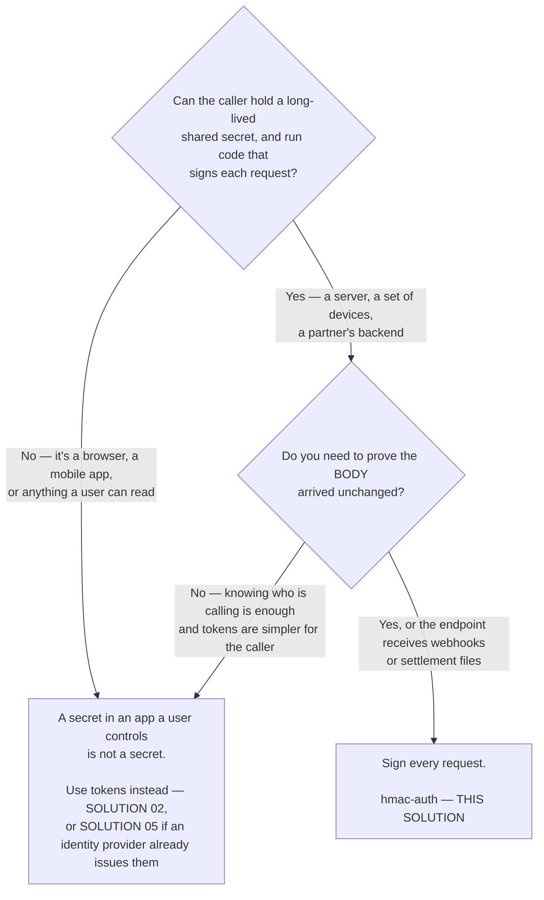
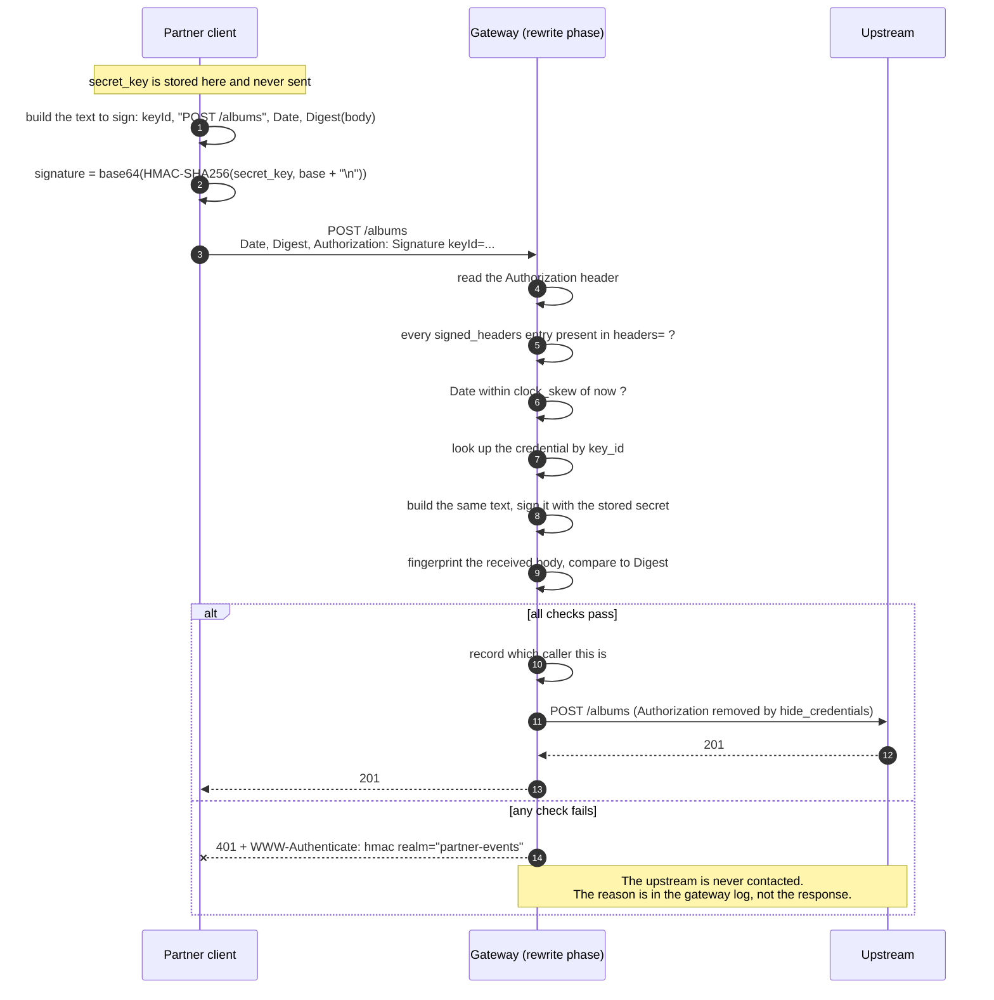
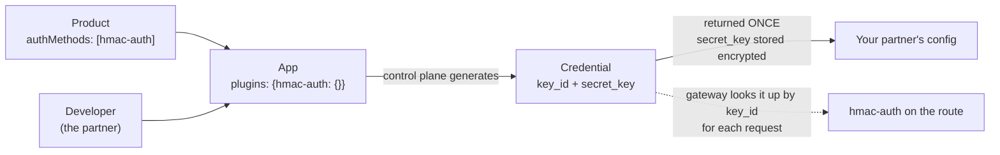

# Architecture — HMAC request signing at the gateway

> [Overview](README.md) · [Business need](business-need.md) · **Architecture** · [Guides](guides.md) · [Agent prompt](helix-agent-prompt.md) · [Tests](tests.md) · [API reference](api-reference.md)

---

## What the gateway does here

The gateway keeps a copy of each caller's secret. When a request arrives, the
gateway **works out the signature again** from that request. Then it checks that
its result matches the signature the caller sent. It does not look a key up in a
list and compare it. Two separate calculations over the same inputs must agree.
Everything else on this page follows from that.

For every signed request, the gateway checks:

1. Does the signature cover everything this route requires (`signed_headers`)?
2. Is the `Date` within 300 seconds of now (`clock_skew`)?
3. Does the signature match, using the secret stored for this `key_id`?
4. On the write route: does the body match the `Digest` header?

If any answer is "no", the gateway stops the request and returns HTTP 401 (not
authenticated). Your backend does not change. It never sees a request that failed.

For the full list of fields on every plugin, see
[docs.digitalapi.ai/api-gateway](https://docs.digitalapi.ai/api-gateway).

## The words used on this page

| Word | What it means |
|---|---|
| **App** | One integration owned by a developer (a partner). Its credential holds the `key_id` and `secret_key`. |
| **Control plane** | The part of the platform where you manage APIs, products, developers and apps. |
| **Upstream** | Your backend service. The gateway forwards requests that pass to it. |
| **`key_id`** | The public name of the credential. Sent with every request. |
| **`secret_key`** | The shared secret. Stored by the caller and in the control plane. **Never sent.** |
| **Signing base** | The exact text the caller builds from the request, and then signs. |
| **HMAC-SHA256** | A standard way to mix a secret with some text into a short code. The same secret and the same text always give the same code. Without the secret, nobody can produce it. |
| **Signature** | `base64(HMAC-SHA256(secret_key, signing base))`. Sent in the `Authorization` header. |
| **Digest** | A fingerprint of the request body: `SHA-256=<base64 of the body's SHA-256>`. Change one character of the body and the fingerprint changes. |
| **`signed_headers`** | The parts of the request each signature **must** cover on this route. |

## Signature or token — decide this first



**Signing is more work for the caller than a token**, and that is the honest
trade-off. On every call, the caller must build the text to sign, take a
fingerprint of the body, and work out the signature. All three must be exactly
right. Ask for signing when the body matters, or when the credential must never be
sent. Do not ask a browser to sign: a secret sent to a user's device is not a
secret, and signing can't fix that.

## How a request flows



The secret is used at both ends. Neither end sends it.

## How a signature is built

Callers get this part wrong most often, so here it is exactly.

**The text to sign (the signing base).** Join these lines with `\n` (a newline),
**and end with a final `\n`**:

1. the `keyId`, alone on the first line
2. then, **in the order they appear in the `headers` field**, one line per entry:
   - `@request-target` becomes `<METHOD> <path-and-query>`, with the method in
     **uppercase**
   - any other name becomes `<name>: <header value>`

```text
demo-key\n
POST /albums\n
date: Wed, 16 Sep 2026 11:12:37 GMT\n
digest: SHA-256=bSNUn7HvRElwnpOx6RaAXbApBPNta7M0chZgmYaCEFI=\n
```

Then `signature = base64(HMAC-SHA256(secret_key, base))`.

**The headers the caller sends:**

```text
Authorization: Signature keyId="<key_id>",algorithm="hmac-sha256",
               headers="@request-target date digest",signature="<base64>"
Date:   <RFC 1123, GMT>
Digest: SHA-256=<base64(sha256(raw request body))>
```

`headers` lists what the text to sign covers, in order, separated by spaces. `Date`
is required whenever `clock_skew` is above zero. `Digest` is required when
`validate_request_body` is on. It is worked out from the **raw body bytes**,
exactly as sent. If anything re-formats the body between signing and sending, the
digest no longer matches.

**It is not draft-cavage, even though the header looks the same.** draft-cavage is
an older public standard called "HTTP Signatures". The `Authorization: Signature
keyId=…` header looks like that standard. But the text that gets signed is
different. So **ready-made HTTP Signatures libraries will not work** with it. The
gateway rejects their signatures with a plain 401.

| | draft-cavage | here |
|---|---|---|
| `keyId` in the text to sign | not included | **first line** |
| Final newline | none | **required** |
| Request target | `(request-target): post /path` | `@request-target`, which becomes `POST /path` |

Each difference on its own changes the signature. Send callers the worked example
in [Guides](guides.md#see-it-work) instead of pointing them at a library.

## Reading a rejection

Every rejection is `401` with the header
`WWW-Authenticate: hmac realm="partner-events"`. The body depends on **where** the
check failed:

| Failure | Body |
|---|---|
| No `Authorization` header | `{"message":"client request can't be validated: missing Authorization header"}` |
| Header does not start with `Signature` | `…: Authorization header does not start with 'Signature'` |
| **Everything else** — `keyId` or `signature` field missing, wrong signature, wrong digest, `Date` outside the time limit, unknown `key_id`, the caller signed less than the route requires | **`{"message":"client request can't be validated"}`** and nothing more |

Only **two** failures are explained: the two the gateway finds while *reading* the
header. Every failure it finds while *checking* the header gets the same short
message. That includes "`keyId` or `signature` missing". It sounds like a reading
error, but the gateway finds it later, so it gets the short message too. We
confirmed this by sending requests to a deployed route. This is correct security
behaviour: an attacker must not learn which check failed. But it also makes it
hard for an honest caller to work out what went wrong. The detail is only in the
gateway's error log:

| Log line | Cause |
|---|---|
| `Invalid signature` | The text to sign does not match. Check the final newline and the `keyId` line first |
| `Invalid digest` | `Digest` does not match the body, or something re-formatted the body |
| `Clock skew exceeded` / `Date header missing` | `Date` is missing, badly formatted, or outside `clock_skew` |
| `expected header "x" missing in signing` | The caller signed less than `signed_headers` requires |
| `Invalid key_id` | No credential with that `key_id`: wrong app, or wrong environment |
| `Invalid algorithm` | The `algorithm` is not in `allowed_algorithms` |

Ask the caller for the `X-Request-Id` from the response. With it, finding the log
line is a single search. That is why `request-id` is in this spec.

## Execution order

Plugins don't run in the order they appear in the file. They run in stages, called
**phases**, and inside a phase by **priority**, highest first. The rewrite phase
runs before the access phase.

| Plugin | Phase | Priority | What it does |
|---|---|---|---|
| `hmac-auth` | rewrite | 2530 | Checks the signature before anything in the access phase, and before the upstream |
| `request-id` | rewrite | — | On the whole API. Adds an `X-Request-Id` header: an id you can use to find the request in the logs |

Two things follow:

- **Rejection happens early.** A bad signature is refused in the rewrite phase, so
  nothing appears in your backend logs. That is expected, not a sign of a problem.
- **`hmac-auth` reads the request body** when `validate_request_body` is on. A
  plugin that runs later and needs the body to have been read already, such as a
  logger with `include_req_body`, relies on that. See
  [solution 07](../07-http-to-kafka/).

**One plugin can't go on the same route: `request-validation`.** It checks the body
against a schema. It also runs in the rewrite phase, at priority 2800, so it runs
before `hmac-auth`. It re-writes the JSON body in a standard form (on purpose, to
block tricks aimed at the parser). `hmac-auth` then takes a fingerprint of the
re-written body, while the caller took a fingerprint of what it actually sent. The
key order and spacing differ, so the two match only by chance. What you see: a
plain 401, with `Invalid digest` in the log. Pick one:

| You want | Do this |
|---|---|
| Proof the body wasn't changed (the point of signing) | `hmac-auth` with `validate_request_body`. Check the schema in your backend, behind the gateway. |
| Bad bodies rejected by schema at the gateway | `request-validation`, and accept that the signature cannot cover the body. |

## Where the secret lives

Nowhere in this package, and nowhere in the spec. That is not just care: there is
no place to put it. `hmac-auth`'s route settings are exactly
`allowed_algorithms`, `clock_skew`, `signed_headers`, `validate_request_body`,
`hide_credentials`, `anonymous_consumer`, `realm` and `_meta`. **There is no
secret field.**

The secret is on the **app credential**, which the control plane manages:



- **The product's `authMethods` must name `hmac-auth`.** The default is
  `helix-auth`. An app under a product that doesn't name `hmac-auth` is rejected.
- **An empty config, `{"hmac-auth": {}}`, tells the control plane to create both
  values.** If you must match a secret a partner already holds, supply your own
  values instead.
- **`secret_key` is returned once**, in the response to the create call, and then
  stored encrypted. Nothing shows it again.
- **Changing the key replaces both values at once.** There is no overlap period
  for the old secret, so the change is instant.
- **One app per integration.** If two partners share a credential, you can't tell
  them apart in the logs, or change one partner's key without changing the
  other's.

Compare [solution 02](../02-oauth-jwt/), where `signing_secret` is a plain value
in the spec. There, if you deploy the spec with its placeholder still in it, the
placeholder becomes your signing key, and anyone can read it. That mistake can't
happen here.

## Settings per route

Each route has different things to sign, so each route has its own list:

| Route | `signed_headers` | `validate_request_body` | Why |
|---|---|---|---|
| `POST /albums` | `@request-target`, `date`, `digest` | `true` | There is a body, so the signature must cover it |
| `GET /albums/{albumId}` | `@request-target`, `date` | `false` | No body. Asking for a fingerprint of nothing adds work, not security |

So `hmac-auth` is attached **to each route, not to the whole API**. One block for
the whole API can't say both. The downside: **a route added later without its own
`hmac-auth` block is open to anyone.** If you would rather be safe by default, move
the `POST` block to the top level of the spec, so it covers the whole API. Callers
of routes with no body then send the fingerprint of an empty body, which is always
`SHA-256=47DEQpj8HBSa+/TImW+5JCeuQeRkm5NMpJWZG3hSuFU=`.

`@request-target` **includes the query string** (the part of the URL after `?`). A
signature for `/albums?page=1` does not match `/albums?page=2`. Anything between
the caller and the gateway that reorders, tidies up or adds query parameters
breaks every signature it touches. The path is covered too: a signature for
`GET /albums/1` returns 200 there and 401 on `/albums/2` (tested).

### `signed_headers` is the setting that makes this secure

Everything else on the route is fine-tuning. This one setting is what makes it
secure.

**Leave it out and the *caller* decides what its own signature covers.** Then a
signature over nothing but the `keyId` is valid. That one signature works for
**any body, any path, for as long as the credential exists**. Even `clock_skew`
stops working: with no `date` in what is signed, there is no `Date` to check.

`validate_request_body` does not save you. It compares `Digest` with the body. But
if `digest` is not in what is signed, the caller supplies both the body *and* a
matching `Digest`, and both checks pass.

With `signed_headers` set, a request whose `headers` field leaves out any required
name is refused *before the signature is even checked*.

## No custom code needed

`hmac-auth` is a standard plugin. The only build work is on the **caller's** side.
That can't be avoided: signing is, by definition, something the caller does.

Things we chose not to build:

- **A record of seen requests, using `lua-callout`, to block resent copies.** It
  would stop someone resending a copied request within the time limit. But it needs
  shared storage, and keeping that storage in step brings its own problems. For
  most endpoints, it is cheaper to make the operation safe to repeat in the
  backend.
- **`request-validation` alongside it.** They can't work together, as explained
  above.
- **Custom reading of the header.** The plugin fixes the format of the
  `Authorization` header.

## When to use this

Use it when:

- the caller is a server, a device or a partner's backend,
- you need proof the body wasn't changed (payments, settlement, telemetry,
  webhooks),
- the credential must stay safe even if requests end up in a log, or
- the other side has already built a signing client for someone else's API.

Use a token instead ([02](../02-oauth-jwt/), [05](../05-okta-jwt/)) when the
caller is a browser or mobile app, when an identity provider already manages who
your users are, or when you need credentials that expire quickly or that identify
each user.

**Signing and `helix-auth` don't go together on one route.** Both plugins work out
who the caller is. Putting both on one route is not supported in this package and
was not tested.

## Prerequisites

- **An org that includes `hmac-auth`.** Check with
  `GET /api/orgs/{orgId}/plugin-schemas?page=1&size=300`. On the build this
  package was checked against, it is there, along with `helix-auth`,
  `basic-auth`, `ldap-auth` and `openid-connect`. `key-auth` and `jwt-auth` are not
  there: they are switched off, and importing a spec that names either one returns
  400 with `key-auth is not an allowed plugin`. `hmac-auth` is not one of the
  switched-off plugins, but check it in *your* org.
- An upstream linked to the revision. (A revision is one saved version of the
  API's configuration.) The spec points at a public test service, so it works on a
  new org.
- A product with `authMethods: ["hmac-auth"]`, a developer, and one app per
  integration.
- Callers whose clocks are within `clock_skew` (300 seconds here) of the real
  time. Devices that don't keep their clocks in sync will get 401s that look like
  credential problems.

## Limits worth knowing

- **It proves who is calling and that the request wasn't changed. It does not
  decide what a caller is allowed to do.** The signature carries no scopes and no
  per-route permissions.
- **Someone can resend a copied request within `clock_skew`.** The plugin has no
  field for a one-time value (a nonce), and keeps no record of requests it has
  seen. A copied request stays valid until its `Date` is more than 300 seconds old.
  To close this gap, make the operation safe to repeat in your backend. The usual
  answer is an event id that the backend checks, so it ignores duplicates. Also
  cut `clock_skew` as far as your callers' clocks allow. A test case shows this
  happening, rather than just stating it. See [Tests](tests.md).
- **The secret is shared**, so the gateway could fake a caller's signature as
  easily as check it. Proving which side sent a message needs a public/private key
  pair instead, which this plugin does not support.
- **A `secret_key` does not expire.** It stays valid until someone changes it.
- **Changing the key is instant, with no overlap.** The old pair stops working at
  once. The workaround is two apps, and a period when both work.
- **The integration work falls on the caller.** Plan for support on the first few
  integrations. Send them the worked example, not a link to a standard.
- **A quota works together with signing (tested).** Adding `api-product-enforcer`
  to a signed route counts usage per app, exactly as
  [solution 01](../01-api-products/) describes. With a quota of 3 a minute, three
  signed requests returned 201 and the next three returned
  `429 {"error":"quota exceeded"}` (HTTP 429, too many requests). It works with no
  extra setup. This package leaves it off because counting usage is solution 01's
  subject.
