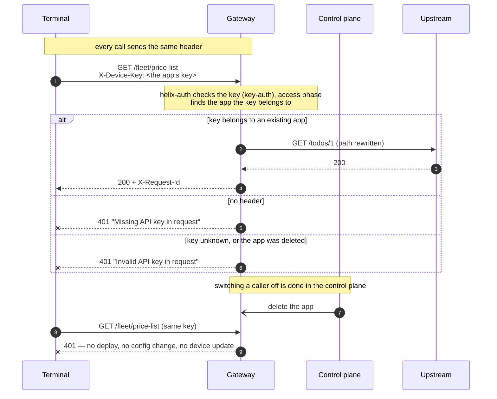

# Architecture — API keys checked at the gateway

> [Overview](README.md) · [Business need](business-need.md) · **Architecture** · [Guides](guides.md) · [Agent prompt](helix-agent-prompt.md) · [Tests](tests.md) · [API reference](api-reference.md)

---

## What the gateway does here

The gateway becomes the one place where every caller is identified. For every
request it answers one question: **which app does this key belong to?**

- If the key belongs to an existing app, the request goes through, marked with
  the name of that app.
- Anything else is refused with HTTP 401 (not authenticated). Your backend is
  not contacted.

Your backend does not change. It never sees a request without a valid key.

**This solution identifies callers. It does not limit them.** It uses the same
`helix-auth` key check as [solution 01](../01-api-products/). It does not use
01's `api-product-enforcer`, so no usage limit is applied. Every app still needs a
product, because signing up to a product is how an app gets its key. Add 01's
limit check when you want limits.

For the full list of fields on every plugin, see
[docs.digitalapi.ai/api-gateway](https://docs.digitalapi.ai/api-gateway).

## The words used on this page

| Word | What it means in Helix | Name used inside the platform |
|---|---|---|
| **Developer** | The company or team that owns the callers | a Consumer |
| **App** | One caller: one terminal, or one partner's scheduled job. It has its own key and secret. | a Credential |
| **Product** | A set of APIs an app signs up to. Here it is how the app gets access. Its quota (usage limit) is not enforced. | a product document |
| **Key** | The value the caller sends in `X-Device-Key`. It is the app's credential *key*, not its id and not its secret. | the credential key |
| **Control plane** | The part of the platform where you manage APIs, products, developers and apps. | — |
| **Upstream** | Your backend service. The gateway forwards requests that pass to it. | — |
| **Terminal** | In this example, a payment card machine. It stands for any device or job that calls the API. | — |

**One app per caller.** If several callers share an app, you lose what this
solution is for. You can no longer tell those callers apart, or switch one off on
its own.

## Which credential fits your caller

A credential is what a caller uses to prove who it is: a key, a token or a
signature. What the caller can do decides which one to use, not personal
preference.

| Your caller | Use | Why |
|---|---|---|
| **Can set a header, nothing more** — a small device, older software that links two systems, a partner's scheduled job | **`helix-auth` validate · key-auth** — this solution | One header. The gateway finds the app. Switch-off takes effect straight away. |
| **Can keep a secret and swap it for a token** — a partner's backend, a server-to-server connection | **`helix-auth` generate + validate** — [solution 02](../02-oauth-jwt/) | The long-lived secret is no longer sent with each request. A leaked token stops working on its own. |
| **Already gets tokens from your identity provider** — Okta, Entra ID, Auth0, Keycloak | **`openid-connect`** — [solution 05](../05-okta-jwt/) | The gateway checks tokens that another system created. It must not create its own. |
| **Can keep a secret, and you need proof the body wasn't changed** | **`hmac-auth`** — [solution 06](../06-hmac-auth/) | The secret is never sent at all. The signature covers the body. |

All four answer "who is calling?". Use exactly one of them on a route.

## How a request flows



The key is checked in the **access phase**, before the request is forwarded (see
[Execution order](#execution-order)). So a refused request costs your backend
nothing. Your backend never sees it, your database never sees it, and it uses
none of your backend's connections.

The terminals call the routes `/fleet/price-list` and `/fleet/takings`. These
paths are a promise to devices that are hard to update, so they must not change.
The backend's paths (`/todos/1` and `/posts` on the public test service) can
change. The `proxy-rewrite` plugin changes the path the gateway forwards to. So
the paths the devices call never have to follow the backend.

## Reading a rejection

| Status | What it means | Where to look |
|---|---|---|
| **401** *Missing API key in request* | Nothing arrived in `X-Device-Key` | The header name in the request, or the key was sent in the URL instead |
| **401** *Invalid API key in request* | Something arrived, but it belongs to no app | Usually the app's id or secret was sent instead of its key, or the app was deleted |
| **403** | HTTP 403 (forbidden). The key belongs to an app, but the app's product does not include this API | Add the API to the app's product. A product problem, not a key problem. |
| **Dry-run rejected**, naming `apikey` | `apikey.source` is missing from the config | See [Settings worth extra attention](#settings-worth-extra-attention) |

(A dry-run is a test deploy that checks the configuration without changing
anything live.)

In [solution 02](../02-oauth-jwt/), both kinds of 401 give the same message.
Here the two messages are different. That helps a genuine caller work out what
went wrong. Treat the message as a hint, not a promise that it will never change.

## Execution order

Plugins don't run in the order they appear in the file. They run in stages, called
**phases**. Inside a phase they run by **priority**, highest number first. The
rewrite phase runs before the access phase.

| Order | Plugin | Phase | Priority | What it does |
|---|---|---|---|---|
| — | `request-id` | — | — | On the whole API. Adds an `X-Request-Id` header: an id you can use to match up log entries for one request |
| 1 | `proxy-rewrite` | rewrite | 1008 | Changes the path sent to the upstream. Takes no part in the key check. |
| 2 | `helix-auth` (validate · key-auth) | access | 2450 | Finds the app from the key. Refuses anything else. |

`helix-auth` has the higher priority number (2450 against 1008), but it still runs
second, because its phase comes later. **Phase beats priority.** On this platform,
this is the most common reason people think the plugins are in the wrong order.

Once `helix-auth` has found the app, later plugins that need to know who is
calling (usage limits, reports) read it from the request. They don't work it out
again.

## Why the key is looked up, not compared

You could instead write one fixed key into the spec and compare the header with
it. That would also "work", but it would be much worse:

| | Fixed value in the config | Looked up on the app |
|---|---|---|
| Where the secret lives | In the spec, in git, in every revision (saved version of the API's configuration) | On the app, created by the control plane |
| Switching off one caller | Edit the API and deploy it again | Delete the app |
| Callers per key | One key, shared by everyone | One per caller |
| Who can see it | Anyone who can read the repository | Nobody; it is never in the document |
| Usage limits and reports | Nothing to count each request under | The app is what both count against |

That is why the spec that comes with this package has no key in it. Leaving the
key out is the design.

## No custom code needed

Everything here is built in. `helix-auth` in `validate` mode with
`validate_auth_type: key-auth` is the platform's own way to identify callers by
API key. It finds the same app that products, usage limits and reports use.

Two other approaches were considered and rejected:

- **A separate `key-auth` plugin.** It does not exist on this build (this version
  of the gateway). `key-auth` and `jwt-auth` are *values* of `helix-auth`'s
  `validate_auth_type` setting, not plugins. Looking for a plugin with that name
  is the most common mistake here.
- **Custom code that checks a header against a list.** It would work, and it
  would be wrong. The list has to be stored somewhere. Switching a caller off
  means deploying a config change again. And no other plugin could see who the
  caller is.

## When to use this

Use it when:

- your callers can set a header but can't swap a secret for a token,
- you need to know each caller, and switch off each caller on its own, without
  touching the backend or the caller's code,
- you hand out one shared key today and want one per caller, or
- you want to identify callers now and add usage limits later.

Do not use it when:

- **the caller can keep a secret and swap it for a token.** Use
  [solution 02](../02-oauth-jwt/). When it is possible, a credential that stops
  working on its own after a while is better.
- **an identity provider already issues tokens to these callers.** Use
  [solution 05](../05-okta-jwt/).
- **you need proof the body wasn't changed** (payments, instructions). Use
  [solution 06](../06-hmac-auth/).
- **you need to know which person is calling.** A key identifies an app, not a
  person.
- **the key can't be kept out of public reach**, as in a public web app or a
  mobile app. A key shipped in code that runs on users' devices is a published key.

## Prerequisites

- The API is imported and deployed, with an upstream linked to it.
- `helix-auth` exists in your org with the fields in this spec. Its exact list of
  fields varies between versions of the gateway. Check it with
  `get_plugin_config` before deploying.
- A product that includes this API, **deployed to the environment**, with a quota
  (every product needs one, even though it isn't enforced here).
- A developer, and **one app per caller** signed up to that product.

## Settings worth extra attention

**`apikey` with `source` is required, whatever the schema says.** The published
schema (the plugin's list of fields) marks it as optional. The plugin's own check
does not. A dry-run rejects the config without it:

```text
property "apikey" with "source" is required when mode is validate
and validate_auth_type is key-auth
```

That is the dry-run catching a real error before deploy. It is working as
intended. Don't expect a default value.

**`secret_validation` is not a second check.** From the plugin's own schema:

> *Key-auth validate only. When true, the credential secret is accepted as an
> **alternative** credential if the api key is absent.*

It **widens** what is accepted. Someone might turn it on hoping the device must
then send both the key and the secret. It does the opposite: a caller that has
only the secret is let in too. This package leaves it off. The behaviour above is
quoted from the schema; this package does not ship or run that variant. If you
want two separate checks, use [solution 06](../06-hmac-auth/).

**Header, not query string.** `apikey.source` accepts `header` or `query` (the
part of the URL after `?`). Choose `header`. A key in a URL is copied into every
access log, proxy log, referrer header and browser history it passes through.
The tests confirm that this configuration **refuses** a key sent in the query
string.

**No `cors`, on purpose.** CORS is a setting that lets web pages in a browser
call the API. Devices are not browsers. A CORS policy that allows every site on
an API for devices would give browser pages a way in that the devices never need.

## Limits worth knowing

- **The key is sent with every request.** Anything that can see a request can
  reuse it: a proxy, a network device that decrypts traffic, or a log that records
  headers. Quick switch-off reduces the damage. It doesn't prevent it.
- **A key never expires.** It works until somebody removes the app. Nothing
  cleans up after you the way a token's lifetime does. Review the live apps
  regularly instead.
- **It identifies the caller. It does not decide what the caller may do.** The
  key proves which app is calling, not what it is allowed to do.
- **The identity is always an app, never a person.** There is no consent step
  and no acting on someone's behalf.
- **Switch-off is not instant to the millisecond.** The gateway keeps a short-term
  copy of credential details (a cache). Measure that delay in your own environment
  and publish *that* as the time it takes to switch a caller off. Don't quote a
  number from here.
- **Giving one app a new key cuts over at once.** The old key stops working the
  moment the new one is live. If your devices update over several weeks, run two
  apps, and delete the old one once every device has the new key.
