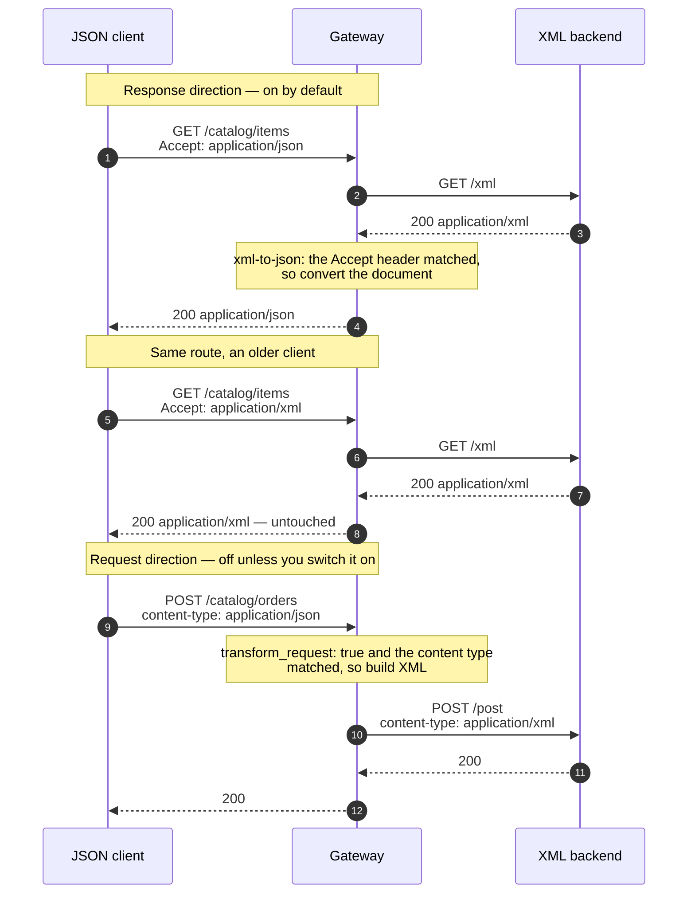

# Solution 09 — JSON in, JSON out, in front of a backend that only speaks XML

**No envelope, no WSDL, no SOAPAction. Just a REST backend from 2009 that answers
in XML, and four client teams who each wrote their own parser.**

| | |
|---|---|
| **Setup time** | ~15 minutes |
| **Difficulty** | 🟢 Beginner |
| **Needs** | A fresh org (its default **test** environment). The upstream is the public httpbin service, so no backend of your own — and because it echoes requests, you can *see* the XML your backend would have received. |
| **Plugins** | `xml-to-json` (both directions) · `proxy-rewrite` · `request-id` · `cors` |
| **Build it with** | 🤖 **[the Helix Agent](helix-agent-prompt.md)** — recommended · or import [`example/api-spec.yaml`](example/api-spec.yaml) |
| **Assets** | ✅ [Agent prompt](helix-agent-prompt.md) · ✅ [Architecture](architecture.md) · ✅ [Business need](business-need.md) · ✅ [Spec](example/) · ✅ [Tests](tests/) · ✅ [Manifest](solution.yaml) |

---

## This is not the SOAP solution

Worth settling in the first ten seconds, because two different people land here
from two different searches.

| | [Solution 03 — SOAP to REST](../03-soap-to-rest/) | **This one** |
|---|---|---|
| The backend | A SOAP service: envelope, `SOAPAction`, one handler path, a WSDL | Plain HTTP that happens to carry XML — an inventory API, a payments file feed, an industry schema |
| What the gateway must build | A whole envelope around your data | Nothing. Element for element, key for key |
| Route shape | Every operation collapses onto one upstream path | Ordinary REST paths |
| Reach for it when | There is a `<soap:Envelope>` anywhere in the conversation | There isn't |

If your backend has an envelope, stop reading and use 03 — this package will
convert your JSON into XML that the SOAP handler rejects. If it doesn't, 03 will
wrap your data in an envelope nothing is expecting. They are not variants of each
other.

## The problem

> *"Our stock system is REST. It's just REST that answers in XML, because it was
> written in 2009 and that was the house style. Every SOAP-to-REST guide we find
> starts by telling us to build an envelope we don't have. Meanwhile the web team
> wrote an XML parser, the iOS team wrote a different one, the Android team found
> a library, and the partner integration team gave up and asked for a nightly CSV.
> Four implementations of the same conversion, and the one that breaks is always
> the one nobody owns."*

The cost is not the format. It is that the conversion has been pushed to the
clients, so it exists four times, in four languages, with four sets of
assumptions about what an empty element means.

**Root cause:** a representation concern is being solved at the wrong layer.
Nothing about turning `<sku>` into `"sku"` requires knowledge of the client or
the domain, so nothing about it needs to live in either.

## Business need

The thirty-second version: [`business-need.md`](business-need.md).

| Dimension | Four client-side parsers | One conversion at the edge |
|---|---|---|
| **Implementations of the conversion** | One per client, in one language each | One, in configuration |
| **Cost of a new client** | Write parser number five | Call the endpoint |
| **Backend change required** | — | None. It keeps speaking XML |
| **When the XML changes** | Four teams, four releases, four timelines | One place to look first |
| **Where representation bugs land** | On the client team that did nothing wrong | In one place, with one owner |
| **Existing XML consumers** | — | Unaffected — they keep getting XML from the same route |

That last row usually decides it. Because the response conversion is
content-negotiated, the old clients do not have to be migrated to put the new
front door in place, and that is often the difference between "approved" and
"next year".

The bugs this removes are intermittent, which is why they are expensive. A client
works for months and breaks the first day a customer has exactly one item in a
basket, because the element stopped being an array. The ticket lands on the client
team, and is diagnosed by whoever knows the XML best, usually on a different team
again.

What this does **not** buy you:

- **An API redesign.** The JSON mirrors the XML, element for element. Awkward XML
  becomes awkward JSON. A stable, versioned contract needs a template transform on
  top.
- **Fidelity.** Attributes on child elements, mixed content and the single-vs-many
  ambiguity are places where XML carries something JSON has no home for. See
  [what the conversion actually does](#what-the-conversion-actually-does-to-your-document).
- **Schema conformance on the way in.** JSON key order is not preserved, so a
  backend validating a strict `xs:sequence` can reject a complete document.
- **Authentication.** This package ships open so the mediation is the only thing
  under test.

No ROI figure is claimed anywhere in this package.

## How a request flows



## Two switches decide whether anything happens at all

Both defaults are reasonable and both surprise people, so they are the first
thing to check when "the plugin isn't doing anything".

**The response transform is content-negotiated.** It fires only when the client
sends `Accept: application/json`. A client that omits the header gets the
backend's XML and concludes the gateway is misconfigured. That behaviour is also
the feature in the table above — it is what lets existing XML consumers keep
working — but it has to be in your client documentation, in bold.

**The request transform is off by default.** `transform_request` defaults to
`false`, so an `xml-to-json: {}` block converts responses *only*. Worse, when it
is on, a body whose `Content-Type` is not in `request_content_types` is forwarded
**unchanged and without an error**. The gateway returns 200; your backend gets
JSON it cannot parse and complains in its own log. Alert on backend parse
failures, not on gateway status codes.

## Configuration

Source of truth: [`example/api-spec.yaml`](example/api-spec.yaml).

Response direction — the minimum useful block:

```yaml
xml-to-json:
  transform_response: true
  content_types: [application/xml, text/xml]
```

Both directions, on the write route:

```yaml
xml-to-json:
  transform_request: true
  transform_response: true
  request_content_types: [application/json]
  content_types: [application/xml, text/xml]
  request_root_name: order
  array_item_name: item
  root_attributes:
    xmlns: "urn:example:catalog"
  max_body_size: 1048576
```

`request_root_name` names the root element of the document you generate, and
`root_attributes` puts the namespace on it. A namespace-aware backend rejects an
otherwise-correct document without that declaration, usually with a message that
does not mention namespaces.

**Do not set `pretty: true`.** Verified on this build: a route with it enabled
returns **503** and the connection is terminated before headers. `root_name` and
`property_naming` are fine; `pretty` is not.

**Do not set `Content-Type` in `proxy-rewrite`.** `proxy-rewrite` (priority 1008)
runs before `xml-to-json` (997) in the rewrite phase, so an override there
changes the header the transform is about to match on, and the request direction
silently stops converting. This exact mistake is on the record against
[solution 03](../03-soap-to-rest/).

## What the conversion actually does to your document

XML and JSON do not have the same shape, so a converter has to make choices. Here
are the ones this plugin makes, observed against a real document rather than read
off a schema.

| XML | Becomes | Watch out for |
|---|---|---|
| A repeated element | A JSON array | **A single occurrence becomes an object, not a one-item array.** The classic intermittent client bug |
| Attributes on the **root** element | Ordinary keys next to the child elements | Indistinguishable from elements once converted |
| Attributes on **child** elements | **Were not present in the converted output** | If data lives in child attributes, check your own document before depending on it |
| An empty element | `null` | Not `""`, and not an absent key |
| Mixed content (`Why <em>X</em> is great`) | Reshaped into separate keys, with the text rejoined | Do not put meaning in mixed content |
| A hyphenated name | An underscored key | `order-id` → `order_id` |

And in the other direction, JSON → XML:

| JSON | Becomes | Watch out for |
|---|---|---|
| An array under a key | Repeated sibling elements named after the key | Not a wrapper element containing children |
| A top-level array | `request_root_name` wrapping `array_item_name` children | Both names are yours to choose |
| Object key order | **Not preserved** | A backend whose schema is an `xs:sequence` can reject a document containing every field it asked for |

That last row is the one to check before promising the request direction to
anyone. If your backend validates against a strict sequence, this plugin is not
the right tool for the request side — a template-based transform is.

## Build it with the Helix Agent

Recommended path, about fifteen minutes. The whole build is **one prompt**:
[`helix-agent-prompt.md`](helix-agent-prompt.md). Paste it as a single message and
replace the `{{...}}` values. Then run [`example/verify.sh`](example/verify.sh)
against it, as under [Testing](#testing). [AGENT-GUIDE.md](../../AGENT-GUIDE.md)
carries the standing rules the prompt assumes.

> **Check what was stored, not what the agent said.** Read the revision back.
> `POST /catalog/orders` should carry `xml-to-json` with **`transform_request:
> true`**, `request_root_name: order`, `array_item_name: item` and the `xmlns` root
> attribute. Neither route's `proxy-rewrite` should set a `Content-Type`, and
> nothing should set `pretty`.

### Why the prompt is worded the way it is

It names no plugin and almost no field. Ask for an outcome and the agent reads
the real `xml-to-json` schema your org ships. Four sentences carry guards:

- **"A JSON body reaches the backend as XML."** That is `transform_request`, which
  defaults to `false`. An agent that writes `xml-to-json: {}` gets the response
  direction working and the request direction silently never happening.
- **"Don't set a Content-Type when retargeting the path."** The one instruction
  kept from the old prompt by name. `proxy-rewrite` (priority 1008) runs before
  `xml-to-json` (997), so an override there changes the header the transform
  matches on, and the request direction stops converting. Removing this guard broke
  [solution 03](../03-soap-to-rest/)'s request transform in a live run, and the
  override is exactly the tidy-up an agent volunteers.
- **The root element, namespace and item name.** Facts about the backend, not
  plugin settings. A namespace-aware backend rejects a document without them,
  usually with a message that doesn't mention namespaces.
- **"Browser clients can … send the Accept header."** The conversion is
  content-negotiated, so a browser that can't send `Accept` can't ask for JSON.

What the prompt no longer carries: the plugin names; `content_types` and
`request_content_types` (the defaults are right); the `pretty` warning (nothing
asks for readable JSON, so nothing invites it; see [Gotchas](#gotchas)); the
empty-fields warning (the dry-run catches it); `request-id`; the `plugins`-map and
`x-helix-gateway` instructions; and the curl step, which is now
[`verify.sh`](example/verify.sh). On 2026-10-13, on `tencent/hy3`, this prompt
built both routes correctly and `verify.sh` passed in full against them. See
[Validation status](#validation-status).

### What the agent decides for you

| | The prompt says | This package's spec | The 2026-10-13 run |
|---|---|---|---|
| CORS | browsers can send `Accept` | `cors` API-wide | `cors` API-wide, `allow_headers: "*"`, `max_age: 5` |
| `content_types` | nothing | `application/xml`, `text/xml` | not set (the same defaults) |
| `max_body_size` | nothing | 1 MiB | not set |
| Correlation id | nothing | `request-id`, API-wide | `request-id`, API-wide |

None of these decides whether the conversion happens. `transform_request` and the
untouched `Content-Type` do.

## Variations

Follow-ups for the same session, once the build above is standing. Use the same
register as the prompt and say what you want to be true.

**My backend sends a different Content-Type**
```text
My backend replies with {{backend_content_type}}, not application/xml. Make the
conversion recognise it on both routes, and tell me what else assumes the default.
```

**I need a stable JSON contract, not a mirror of the XML**
```text
This JSON mirrors the backend's element names, and I need a contract that survives
a backend refactor. Show me a template-based transform for the GET route instead,
and be explicit about what I take on by maintaining the template.
```

**My backend validates a strict xs:sequence**
```text
My backend's schema is an xs:sequence, so element order matters. Tell me plainly
whether the request conversion can guarantee order, and if not, show me a
template-based alternative for the POST route only.
```

**Put identity in front of it**
```text
Require an app's API key in the X-Api-Key header on both routes, and keep the
conversion exactly as it is. Then create a developer, a product and an app, and
give me the key.
```
That is [08](../08-api-key/).

## When the agent goes wrong

**Read the stored revision before you trust any of it.**

| Symptom | Cause |
|---|---|
| The response is still XML | The client didn't send `Accept: application/json`, or the upstream's `Content-Type` isn't in `content_types`. |
| The backend rejects the request body | `transform_request` is false, or the client's content type isn't in `request_content_types`. |
| Everything returns 200 and the backend still complains | Both gates fail **open**. The gateway's status code is not evidence the conversion happened. |
| The request direction stops working after an edit | Something added a `Content-Type` to `proxy-rewrite`. |
| 503 with the connection dropped | `pretty: true` is set. Remove it. |
| The dry-run fails while the agent adds a browser preflight route | Seen on 2026-10-13: the agent tried a separate `/*` OPTIONS route, which this environment refused. It recovered by relying on `cors` alone. Read the revision back. |
| The dry-run fails on `proxy-rewrite` | The agent added empty optional fields (`headers: {}`, a `regex_uri` of nulls). Set only `uri`. |
| The routes exist with **no plugins**, at exit 0 | The agent wrapped them in `x-helix-gateway` inside the live route object, which a live route silently discards. |
| Deploy fails: `Only INACTIVE revisions can be updated` | Clone the revision or undeploy, then apply. |

## Install it directly

```bash
export ORG=<ORG_ID>
export TOKEN=<control-plane bearer token>      # short-lived
export BASE=https://<YOUR_GATEWAY_HOST>/api

# 1. Import example/api-spec.yaml. Nothing in it needs filling in.
# 2. Bind your XML backend as the upstream and deploy the revision to "test".
# 3. Adjust the proxy-rewrite paths to your backend's, and content_types to the
#    Content-Type your backend actually sends (check it — text/html and
#    application/soap+xml do not match the defaults).
# 4. Prove it
GATEWAY=https://<YOUR_GATEWAY_HOST> ./example/verify.sh
#    Against your own backend (which probably does not echo requests):
GATEWAY=https://<YOUR_GATEWAY_HOST> ECHOES_REQUEST=0 ./example/verify.sh
```

## Testing

Exit 0 means all five cases held:

| # | Case | Expected |
|---|---|---|
| 1 | `Accept: application/json` on the read route | `200` JSON, no XML markup left |
| 2 | **`Accept: application/xml` on the same route** | `200` the backend's XML, untouched |
| 3 | A JSON order body | `200`, and the backend received `<order>` with the namespace |
| 4 | **The same body sent as `text/plain`** | `200`, forwarded **unchanged** |
| 5 | A malformed JSON body | `400` at the gateway |

**Cases 2 and 4 are the ones worth keeping.** Both assert what the plugin
deliberately does *not* do, and both are the behaviour people later mistake for a
bug. Case 4 in particular is the failure that reaches production: nothing in the
gateway's response indicates the transform was skipped.

The single-element-array and attribute-fidelity cases are manual, because the
answer depends on your document rather than on the configuration —
[`tests/test-plan.yaml`](tests/test-plan.yaml) has the procedure for both.

## Gotchas

- **No `Accept: application/json`, no conversion.** The first thing to check.
- **`transform_request` defaults to `false`.** An empty block converts responses
  only.
- **A content type outside `request_content_types` passes through silently.** So
  does a body over `max_body_size`. Neither produces an error.
- **`pretty: true` returns 503 on this build.** Verified. Leave it off.
- **Never set `Content-Type` in `proxy-rewrite` on a route that converts
  requests.** It runs first and breaks the match.
- **Check what your backend actually sends.** `content_types` defaults to
  `application/xml` and `text/xml`. A backend replying `text/html` or
  `application/soap+xml` matches neither.
- **A single occurrence of a repeatable element is an object, not an array.**
  Write clients that tolerate both, or normalise in your own layer.
- **JSON key order is not preserved on the way to XML.** Fatal with a strict
  `xs:sequence` schema, invisible otherwise.
- **Conversion failures are reported by the *backend*, not the gateway.** Which
  is why `request-id` is on every route here.

## When to use it

Use it when:

- Your backend speaks XML over ordinary HTTP and there is no envelope in sight.
- More than one client has written, or is about to write, its own parser.
- You need to add JSON clients without migrating the XML ones.
- The XML is well-formed and data lives in elements rather than attributes.

Don't use it when:

- **There is a SOAP envelope.** Use [solution 03](../03-soap-to-rest/).
- **Your backend validates against a strict `xs:sequence`** and you need the
  request direction. Key order is not preserved; use a template-based transform.
- **Meaning lives in attributes or mixed content.** The conversion is lossy there.
- **You need a stable, versioned JSON contract** that is independent of the XML.
  This mirrors the backend's structure, so a backend refactor is a client-visible
  change. Put a response template in front if that matters.
- **The documents are large.** Conversion buffers the body, and anything over
  `max_body_size` is passed through unconverted.

## Limitations

- **Content-negotiated in one direction, content-type-gated in the other.** Both
  gates fail open — the request passes through unconverted rather than erroring.
- **Attributes on child elements did not survive conversion** in this package's
  validation run. Root attributes did. Check your own document.
- **Single occurrence vs array is ambiguous** and resolved by what the document
  happens to contain.
- **Empty elements become `null`.**
- **Mixed content is reshaped, not preserved.**
- **Key order is not preserved on JSON → XML.**
- **`pretty: true` breaks the route on this build (503).**
- **The JSON contract is a mirror of the XML.** No independent versioning.
- **Bodies over `max_body_size` are forwarded unconverted, silently.**

Full list: [`solution.yaml`](solution.yaml) § `limitations`.

## Validation status

**Validated against a gateway — imported, dry-run, deployed, and exercised.**

| Stage | Status | Provenance |
|---|---|---|
| Configuration generated | **YES** | [`example/api-spec.yaml`](example/api-spec.yaml) |
| Local validation | **PASS** | Structural review of the spec and tests |
| Gateway dry-run | **PASS** | Non-destructive, against a temporary import. |
| Gateway deployed | **DEPLOYED** | Revision ACTIVE in a test environment. |
| Functional tests | **PASS (5/5)** | Both directions, both silent-passthrough assertions, and the malformed-body rejection. |
| Agent-mode run | **PASS (config + functional)**, 2026-10-13, `tencent/hy3` | The current prompt, run once. The stored revision had `transform_request: true`, the root name, item name and namespace, and no `Content-Type` override. `verify.sh` passed every check against the agent-built routes. The dry-run failed twice while the agent tried a separate preflight route, then passed without it. **The routes ran under an `/agentrun-09` prefix**, because this package's reference API holds the bare paths in that environment |

Overall: **READY.** The `pretty: true` defect and the conversion-fidelity
observations were both produced by this actual run, not read off a schema.

## Related solutions

- **[03 — SOAP to REST](../03-soap-to-rest/)** — the envelope case. Read the table
  at the top before choosing.
- **[08 — API keys](../08-api-key/)** · **[02 — OAuth 2.0 with JWT](../02-oauth-jwt/)** —
  this package ships unauthenticated so the mediation is the only thing being
  demonstrated. Put one of these in front before it carries anything real.
- **[10 — Data masking](../10-data-mask/)** — for when the converted response
  contains more than the client should see.
