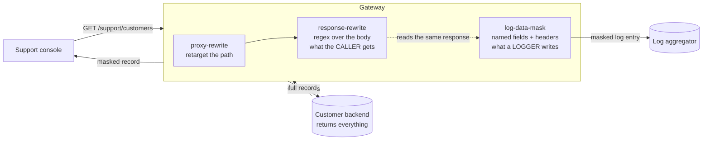

# Solution 10 — mask the values, not just the log line

**Two different masks, two different purposes. One changes what the support agent
reads; the other changes what the log aggregator keeps. Shipping the wrong one is
the standard way this project fails.**

| | |
|---|---|
| **Setup time** | ~15 minutes |
| **Difficulty** | 🟢 Beginner |
| **Needs** | A fresh org (its default **test** environment). The upstream is public jsonplaceholder, whose customer records carry email, phone and precise coordinates — so the masking is visible with no backend of your own. A logger plugin and a sink you can read, if you want to verify the log half too. |
| **Plugins** | `response-rewrite` · `log-data-mask` · `proxy-rewrite` · `request-id` |
| **Build it with** | 🤖 **[the Helix Agent](helix-agent-prompt.md)** — recommended · or import [`example/api-spec.yaml`](example/api-spec.yaml) |
| **Assets** | ✅ [Agent prompt](helix-agent-prompt.md) · ✅ [Architecture](architecture.md) · ✅ [Business need](business-need.md) · ✅ [Spec](example/) · ✅ [Tests](tests/) · ✅ [Manifest](solution.yaml) |

---

## The problem

> *"Audit flagged customer PII in our log aggregator, so we have a ticket to mask
> the logs. While we were reading the sample log lines it became obvious that the
> support console shows agents the same thing — every customer's full email,
> full phone number, and the coordinates of their house. Two hundred agents, a
> contact-centre with turnover, and none of them need any of it. The backend is a
> shared service on a quarterly release train, so 'return less' is not a change we
> can make this year."*

Two exposures, one root cause, and they are usually treated as one ticket:

1. **The screen.** Every agent sees every field the backend returns, because
   nobody scoped the response to the job.
2. **The logs.** The same payload is copied into a system with different access
   control, longer retention, and a much larger audience.

**Root cause:** the backend returns one representation and every consumer gets it
whole. Narrowing it per consumer is a backend change nobody can schedule — so it
does not happen, and the exposure is renewed every release.

## Business need

The thirty-second version: [`business-need.md`](business-need.md).

| Dimension | Every consumer gets the whole record | Masked at the edge |
|---|---|---|
| **What a support agent sees** | Every field the backend returns | Only what the job needs |
| **PII in the log aggregator** | A copy of every response | Redacted, with credentials stripped |
| **Narrowing the response** | A backend schema change on someone else's release train | A configuration change and a revision deploy |
| **"Is it masked?"** | Answered by reading config | Answered by a test over every record in a real response |
| **A new consumer** | Inherits the full exposure | Inherits the masked view |

The log aggregator is usually the audit finding, because it is searchable and an
auditor can see it. The support screen is the larger exposure: a bigger audience,
less access control, and no retention policy, because nobody thinks of a screen as
storage.

Masking projects fail in two ways, and this package is built against both. **The
mask made the job harder**: replace the whole email and support can no longer tell
customer organisations apart, so the control gets an exception, then a rollback.
Here the local part goes and the domain stays. **It was never verified**: the
default masks only the first match, which leaves the first record, the one in
every screenshot, looking right. Here a test asserts every record.

What this does **not** buy you:

- **Access control.** A caller who should not see the record at all must be
  stopped by identity. Masking narrows what a legitimate caller sees.
- **Tokenisation.** The masked value is not reversible and not a valid identifier.
- **Data that never leaves the backend.** The upstream still returns it, and the
  gateway holds it in memory to rewrite it.
- **Fields it was not told about.** The same value under another key, inside an
  encoded string, or quoted in an error message passes through.

No ROI figure is claimed anywhere in this package.

## Two masks. Do not confuse them.

This is the whole solution, and getting it wrong is the standard failure.

| | `response-rewrite` | `log-data-mask` |
|---|---|---|
| **Changes** | What the **caller** receives | What a **logger** writes |
| **Effect on the response** | The point | **None** |
| **Effect on the logs** | Indirect — loggers usually record the rewritten body | The point |
| **Needs anything else on the route?** | No | **Yes — a logger plugin.** With none, it does nothing at all |
| **Affects analytics?** | No | No |
| **How it selects** | A regex over the body text | Named fields, parsed |
| **Stops a stolen screenshot** | Yes | No |
| **Stops PII in the log aggregator** | Usually, as a side effect | Yes, and headers too |

Verified live, on two routes that differed only in this: a route carrying
**only** `log-data-mask` returned the caller `Sincere@april.biz` and
`1-770-736-8031` in full, while its log entry carried `[redacted]` in both
places and no `Authorization` header at all. The same audit finding produces both
tickets, so the log control gets configured first — and the screen keeps showing
everything.

Ship both. This package does.

## How a request flows



The backend keeps returning everything. Nothing downstream of the gateway sees
the full record except the gateway itself.

## Configuration

Source of truth: [`example/api-spec.yaml`](example/api-spec.yaml).

What the caller sees:

```yaml
response-rewrite:
  filters:
    - regex: '("email"\s*:\s*")[^"@]+@'
      replace: '$1***@'
      scope: global
    - regex: '("phone"\s*:\s*")[^"]*"'
      replace: '$1[redacted]"'
      scope: global
```

What a logger writes:

```yaml
log-data-mask:
  response:
    - { type: body, name: email, action: replace, value: "[redacted]", body_format: json }
    - { type: body, name: phone, action: replace, value: "[redacted]", body_format: json }
  request:
    - { type: header, name: authorization, action: remove }
```

### `scope: global` is not optional

`scope` defaults to **`once`**. A filter without it masks the **first** match in
the body and leaves every other one.

On a ten-record list that is one masked record and nine in the clear. Verified
deliberately during this package's validation: with the default scope, **1 of 10**
records was masked. And because it is the *first* record, it is the one in every
screenshot, every demo and every code-review sample — the configuration looks
correct in exactly the view people check it in.

If you take one thing from this package, take that.

### The mask is a regex, not a parser

That is the strength — it needs no knowledge of your schema, and it works on a
response shape you have never seen. It is also the limit, and the limit is sharp:

- **A value under a different key is not masked.** The filter is anchored on
  `"email"`. A copy of the same address in `contactEmail`, or in a free-text note,
  or in an error message, passes straight through.
- **A value inside an encoded string is not masked.** Base64, URL-encoded,
  a nested JSON string — the regex sees text, not meaning.
- **A pattern that is too broad corrupts data silently.** Every filter here is
  anchored on its own field name for that reason, and one test asserts that
  unfiltered fields come back untouched.

Run the encoded-and-renamed-fields case in
[`tests/test-plan.yaml`](tests/test-plan.yaml) against **real** payloads before
you rely on this. Error messages and audit-trail fields are where copies hide.

### Why the email keeps its domain

`***@april.biz`, not `[redacted]`. Support uses the domain to tell which customer
organisation a person belongs to; the local part is the identifying half. A mask
that removes the whole address makes the console worse at its job, and a control
that makes the job harder without a visible benefit is a control that gets
switched off two sprints later.

Mask what is sensitive. Keep what is useful. They are usually different halves of
the same field.

## Build it with the Helix Agent

Recommended path, about fifteen minutes. The whole build is **one prompt**:
[`helix-agent-prompt.md`](helix-agent-prompt.md). Paste it as a single message and
replace the `{{...}}` values. Then run [`example/verify.sh`](example/verify.sh)
against it, as under [Testing](#testing). [AGENT-GUIDE.md](../../AGENT-GUIDE.md)
carries the standing rules the prompt assumes.

> **Check what was stored, not what the agent said.** Read the revision back. Both
> routes should carry `response-rewrite` with **`scope: global` on every filter**,
> each pattern anchored on its own field name, and `log-data-mask` with the email
> and phone body fields and the `Authorization` header. The single-record route's
> `proxy-rewrite` must carry the id through (a `regex_uri`), not a fixed `uri`.
> Then run `verify.sh`: a bad pattern shows in one response.

### Why the prompt is worded the way it is

It names no plugin, no field and no pattern. Earlier versions handed the agent
four regular expressions verbatim, because one agent run had invented a
replacement that would have written a literal `[^"]*` into every response. This one
describes the result instead, and four sentences carry the guards:

- **"In every record of every response, not just the first."** This is `scope:
  global`. The default is `once`: one match, then stop. On a list it masks the
  first record and leaves the rest, and the first record is the one in every
  screenshot.
- **"So `Sincere@april.biz` reads `***@april.biz`."** A worked example pins the
  replacement more tightly than a description of it, and it is the check the
  reader runs by eye.
- **"Masking must match a field however it is spaced."** The guard that decides
  whether anything is masked at all. The agent writes its patterns against the
  JSON it imagines, and a pattern written for compact JSON (`"email":"`) matches
  nothing in jsonplaceholder's `"email": "Sincere@april.biz"`. Every response then
  passes through unmasked, with a 200 and no error. An operator's build of an
  earlier wording did exactly that on 2026-10-13; see
  [Validation status](#validation-status).
- **"Don't add a logger now. … if one is added to these routes later."** This
  is `log-data-mask`, configured without a logger or a sink. It changes only what a
  logger writes, does nothing without one, and never changes the response. The
  first half was added after a build read "if a logger is added" as an
  instruction, and added a `file-logger`. Whether it prevents that is not yet
  measured. See [Two masks](#two-masks-do-not-confuse-them).

The prompt is also **one block instead of four steps**. The split was a workaround
for malformed tool arguments on large route writes, measured on an older agent
model. On 2026-10-13, on `tencent/hy3`, the agent wrote both routes with all three
plugins in a single write and `verify.sh` passed 6/6 against them. See
[Validation status](#validation-status).

What the prompt no longer carries: the patterns themselves; `scope`, `regex_uri`
and `request-id` by name; the upstream-reuse note; the `plugins`-map and
`x-helix-gateway` instructions; and "tell me what `log-data-mask` does not do".

### What the agent decides for you

| | The prompt says | This package's spec | First `tencent/hy3` build |
|---|---|---|---|
| Whitespace around `:` | any spacing | `\s*:\s*` | `\s*:\s*` (an operator's build of the earlier wording: none, so nothing matched) |
| Email pattern | local part → `***` | `[^"@]+@` | `[^"@]*@` (also matches an empty local part) |
| Single-record rewrite | the id reaches `/users/:customerId` | `regex_uri` | `regex_uri` |
| Log mask value | redacted | `[redacted]` | `[redacted]` |
| Correlation id | nothing | `request-id`, API-wide | `request-id`, API-wide |
| Where the masks sit | both routes | on each route | on each route (the current wording's build: API-wide) |
| A logger | only "if one is added" | none | none (the current wording's build added `file-logger`) |
| Authentication | nothing | none — ships open | none (the agent flagged it and offered to add it) |

None of these changes what the caller sees. `scope: global` and the anchored
patterns do.

## Variations

Follow-ups for the same session, once the build above is standing. Use the same
register as the prompt and say what you want to be true.

**Prove the log half too**
```text
Add a logger to both routes that sends each request and response body to
{{log_sink_url}} as soon as it happens. Then tell me how to compare one logged
entry with and without the log masking, because that comparison is the only proof
the log mask works.
```

**My payload names the fields differently**
```text
My records use contactEmail, mobileNumber and homeLat/homeLng. Mask those instead,
in the response and in the logs, and remind me what happens to a copy of the same
value stored under another key.
```

**Mask by role rather than for everyone**
```text
Only agents in the support tier should get the masked view; the fraud team needs
the full record. Tell me honestly whether one route can do that, and if not, what
the two-route shape looks like and how the caller is identified.
```

**Put identity in front of it**
```text
Require an app's API key in the X-Api-Key header on both routes, and keep the
masking exactly as it is. Then create a developer, a product and an app, and give
me the key.
```
That is [08](../08-api-key/). Masking is not access control.

## When the agent goes wrong

**Read the stored revision before you trust any of it.**

| Symptom | Cause |
|---|---|
| Only the first record is masked | A filter is missing `scope: global`. |
| Nothing is masked, every call returns 200 | The patterns assume compact JSON (`"email":"`) and the backend sends `"email": "…"`. Seen on 2026-10-13. Ask for patterns that match however the field is spaced. |
| Nothing is masked | The pattern doesn't match the serialised body. Check key spelling and whitespace, and whether something on the route converts the format first. |
| A field nobody asked about is mangled | An over-broad pattern. Anchor each one on its field name. |
| A literal `[^"]*` appears in responses | The agent put regex syntax in the *replacement*. Replacements take `$1` and plain text only. |
| The single-record route returns 404 | The route was stored as `/support/customers/{customerId}`. Live routes take `/:customerId`; only spec import rewrites the braces. Seen on 2026-10-13 with the prompt writing `:customerId`. Fix the path by hand. |
| A `file-logger` appears on the API | The agent read "if a logger is added" as an instruction to add one (2026-10-13, before the prompt said not to). It writes masked bodies to a file on the gateway. Remove it if you didn't want it. |
| Every single-record call returns the same customer | The rewrite is a fixed `uri`. It needs a `regex_uri` that carries the id. |
| The agent says the logs are masked, with no logger on the route | `log-data-mask` has no effect without a logger, and never changes the response. |
| `stream closed with reason: error` after a route write | Malformed tool arguments; nothing was written. Seen on an older model with the whole spec in one write. Retry once; if it repeats, import [`example/api-spec.yaml`](example/api-spec.yaml). |
| The agent says the routes are built, and the API has **no routes** | The route write reported success and stored nothing (2026-10-13). The agent may still offer to deploy. Read the revision back; if it is empty, ask for the routes again or import [`example/api-spec.yaml`](example/api-spec.yaml). |
| The routes exist with **no plugins**, at exit 0 | The agent wrapped them in `x-helix-gateway` inside the live route object, which a live route silently discards. |
| Deploy fails: `Only INACTIVE revisions can be updated` | Clone the revision or undeploy, then apply. |

## Install it directly

```bash
export ORG=<ORG_ID>
export TOKEN=<control-plane bearer token>      # short-lived
export BASE=https://<YOUR_GATEWAY_HOST>/api

# 1. Import example/api-spec.yaml. Nothing in it needs filling in.
# 2. Bind your upstream and deploy the revision to "test".
# 3. Adjust the field names in BOTH plugin blocks to your payload, and the
#    proxy-rewrite paths to your backend.
# 4. Prove it
GATEWAY=https://<YOUR_GATEWAY_HOST> ./example/verify.sh
```

## Testing

Exit 0 means all six response-side cases held:

| # | Case | Expected |
|---|---|---|
| 1 | **Every** record in the list | email local part masked — not just the first |
| 2 | The email domain | still readable |
| 3 | Every phone number | `[redacted]` |
| 4 | Every coordinate | `[redacted]` |
| 5 | A field the filters don't name | untouched |
| 6 | The single-record route | masked identically |

**Case 1 is the one that matters.** It is the `scope: once` trap, asserted rather
than hoped for. Case 5 is its mirror: proof the patterns are anchored and are not
quietly corrupting fields nobody asked to mask.

`verify.sh` cannot check the log half — no client-side assertion can see what a
logger wrote. [`tests/test-plan.yaml`](tests/test-plan.yaml) carries the
procedure, and this package's validation run executed it: a logger on the route,
a sink whose received body was read back, and the same route with `log-data-mask`
removed for comparison.

## Gotchas

- **`scope` defaults to `once`.** One record masked, the rest in the clear, and the
  masked one is the one you look at.
- **`log-data-mask` does nothing without a logger on the route.** It is read by the
  shared log helper the logger plugins use. It is not a response filter.
- **`log-data-mask` does not change the response.** Verified. A route with only
  that plugin sends the caller everything.
- **It does not affect analytics either.** Analytics does not go through the log
  helper.
- **Masking is not access control.** A caller who should not see the record at all
  must be stopped by identity — [solution 08](../08-api-key/) or
  [solution 02](../02-oauth-jwt/). This package ships unauthenticated so the
  masking is the only thing under test; do not deploy it that way.
- **The regex sees text, not meaning.** Renamed keys, encoded strings and free-text
  copies are not masked.
- **A broad pattern corrupts data.** Anchor every filter on its own field name.
- **If you also convert formats on this route** ([solution 09](../09-xml-to-json/)),
  the converter runs first — write the patterns against the *converted* body.
- **A masked response is harder to support.** The agent cannot read back the value
  they are asking about. `request-id` is on every route here for that reason.

## When to use it

Use it when:

- A response carries more than its consumer needs, and narrowing it at the backend
  is not schedulable.
- An audit finding names PII in logs — and while you are there, on screens.
- You need the same rule applied consistently across many consumers, which is
  exactly what a single point of egress is for.
- You want a control you can demonstrate to an auditor in a single response.

Don't use it when:

- **The caller should not see the record at all.** That is authentication and
  authorization, not masking.
- **Meaning is carried in free text or encoded fields.** Regex masking cannot find
  what it was not given the name of.
- **You need format-preserving tokenisation** — a masked value that is still a
  valid, reversible identifier. Different tool entirely.
- **The data must never be in the response even transiently.** The backend still
  returns it and the gateway still holds it in memory. If that is unacceptable, the
  fix is at the backend.

## Limitations

- **`scope` defaults to `once`.** The most dangerous default here.
- **Regex, not parsing.** Renamed keys, encoded strings and free-text copies are
  missed; over-broad patterns corrupt data silently.
- **`log-data-mask` requires a logger on the route** and affects nothing else.
- **The two controls are independent.** Neither implies the other.
- **Masking is not access control.**
- **Not format-preserving and not reversible.** There is no token to map back.
- **The upstream still returns the sensitive data** and the gateway holds it in
  memory to rewrite it.
- **Body rewriting buffers the response**, which costs memory on large payloads.

Full list: [`solution.yaml`](solution.yaml) § `limitations`.

## Validation status

**Validated against a gateway — imported, dry-run, deployed, and exercised.**

| Stage | Status | Provenance |
|---|---|---|
| Configuration generated | **YES** | [`example/api-spec.yaml`](example/api-spec.yaml) |
| Local validation | **PASS** | Structural review of the spec and tests |
| Gateway dry-run | **PASS** | Non-destructive, against a temporary import. |
| Gateway deployed | **DEPLOYED** | Revision ACTIVE in a test environment. |
| Functional tests | **PASS (6/6)** | Response side by `verify.sh`; the log side verified separately against a real logger and a readable sink. |
| Agent-mode run, current wording | **Not driven by the build tooling** | The operator's wording, shipped modulo placeholders and one missing `/` in the second route. It states "however it is spaced" instead of describing the backend, and drops `X-Api-Key` from the log mask. No build of it is recorded here |
| Agent-mode run, logger wording | **Not built**, 2026-10-13, `tencent/hy3` | One build of the pretty-printed wording plus "don't add a logger now". The route write reported success and stored **no routes**, and no `log-data-mask`. The agent then offered to deploy the empty API, describing two masked routes. Not deployed; whether the logger sentence works is unmeasured. Read the revision back before any deploy |
| Agent-mode run, pretty-printed wording | **Masking PASS; single-record route 404**, 2026-10-13, `tencent/hy3` | The wording with the pretty-printed sentence and without "don't add a logger now". All six filters whitespace-tolerant, `scope: global`, placed API-wide. `verify.sh` passed the five list-route checks. **The single-record route was stored as `/{customerId}` and returns 404**, despite the prompt writing `:customerId`; see [When the agent goes wrong](#when-the-agent-goes-wrong). The agent also added a `file-logger` nobody asked for |
| Agent-mode run, first wording | **1 of 2 builds masked anything**, 2026-10-13 | The wording before the pretty-printed sentence. One build on `tencent/hy3` passed `verify.sh` 6/6. **The operator's build masked nothing**: its patterns assumed compact JSON and matched 0 of 10 records (model not recorded) |

The agent-mode builds ran under an `/agentrun-10` path prefix, because this package's reference API holds the bare paths in that environment.

Overall: **READY.** The `scope: once` behaviour and the independence of the two
masks were both reproduced deliberately, not inferred.

## Related solutions

- **[08 — API keys](../08-api-key/)** · **[02 — OAuth 2.0 with JWT](../02-oauth-jwt/)** —
  masking is not access control. Put one of these in front.
- **[09 — XML to JSON](../09-xml-to-json/)** — if you convert on the same route,
  the converter runs first and your patterns must match the converted body.
- **[04 — Analytics](../04-analytics/)** — analytics does not pass through the log
  helper, so `log-data-mask` does not touch it.
