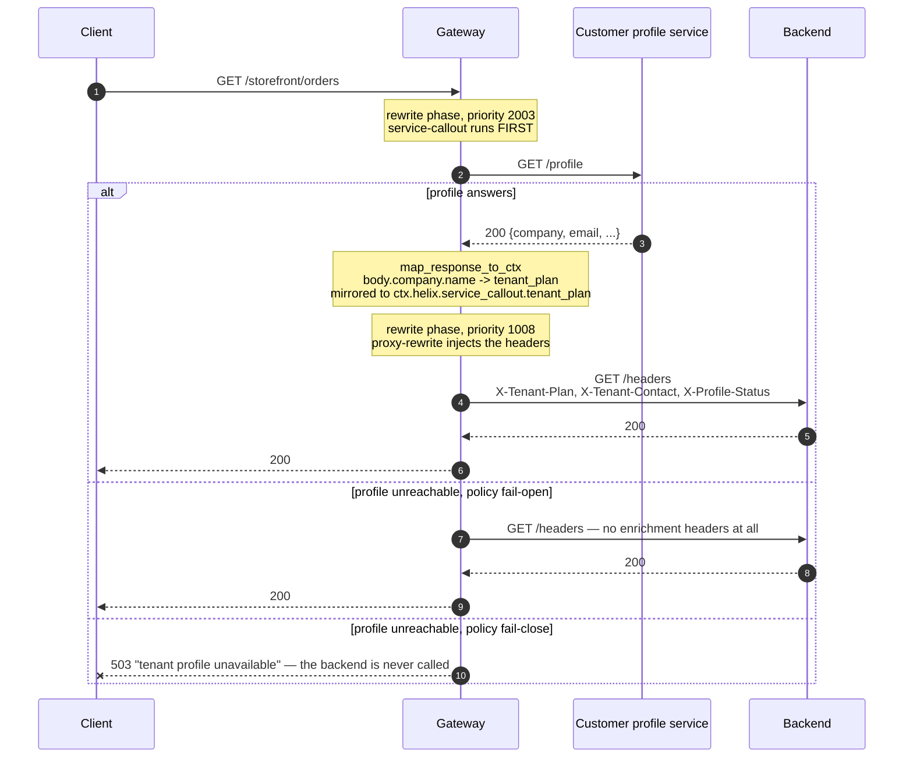

# Solution 11 — the lookup every service re-implements, done once at the edge

**Three teams cache the same tenant-profile call three different ways, and one of
them is wrong. Make the call once, before the request is proxied, and hand the
answer to the backend as a header.**

| | |
|---|---|
| **Setup time** | ~15 minutes |
| **Difficulty** | 🟢 Beginner |
| **Needs** | A fresh org (its default **test** environment). Nothing to fill in — the upstream echoes request headers so you can see what the backend received, and the callout target is a public sample service standing in for your own. |
| **Plugins** | `service-callout` · `proxy-rewrite` · `request-id` |
| **Build it with** | 🤖 **[the Helix Agent](helix-agent-prompt.md)** — recommended · or import [`example/api-spec.yaml`](example/api-spec.yaml) |
| **Assets** | ✅ [Agent prompt](helix-agent-prompt.md) · ✅ [Architecture](architecture.md) · ✅ [Business need](business-need.md) · ✅ [Spec](example/) · ✅ [Tests](tests/) · ✅ [Manifest](solution.yaml) |

---

## The problem

> *"Every service we own starts the same way: call the customer-profile service,
> find out what plan this tenant is on and whether the account is in arrears, then
> get on with the actual work. Orders caches it for five minutes. Billing caches it
> for an hour. Notifications doesn't cache it at all and is the reason profile
> gets paged. When profile is slow, all three are slow in three different ways, and
> when we changed the field name last quarter we found the seventh copy of that
> call in a service nobody had touched since 2023."*

The lookup is not hard. Having it in N places is:

1. **N caching strategies**, of which at most one is right.
2. **N failure behaviours** — one retries, one fails open, one fails the request.
3. **N places to change** when the profile service's contract moves.
4. **N × traffic** on the profile service, because nothing is shared.

**Root cause:** a cross-cutting lookup is being treated as application logic. Every
caller needs the same answer, before it does anything else — which is a property of
the *path*, not of any one service.

## Business need

The thirty-second version: [`business-need.md`](business-need.md).

| Dimension | The lookup in every service | One callout at the edge |
|---|---|---|
| **Implementations** | One per service, each with its own cache and timeout | One, in configuration |
| **Changing the contract** | Find every copy; coordinate N releases | One place |
| **Failure behaviour** | Whatever each team chose, undocumented | An explicit policy per route |
| **Load on the profile service** | One call per service per request | One call per request |
| **A new service** | Implements the lookup before it starts | Reads a header |

The part that pays for the work is not the deduplication, it is the onboarding.
Once the enrichment is on the route, every new service behind it starts with the
answer already in hand. The lookup stops being the first thing each team builds and
becomes something it inherits.

The failure policy is the most consequential choice here, and it was never really
made before: one service retried, one failed open, one failed the request, each
decided by whoever wrote it, under a deadline. The first slow day of the profile
service is when the estate finds out what it actually does. Here the policy is
written on each route.

What this does **not** buy you:

- **An authorization decision.** The callout fetches an answer; it does not act on
  it. Rejecting a caller on the response needs a plugin built to return a verdict.
- **Fewer dependencies.** One synchronous call stays in the request path, and its
  timeout is now part of your latency budget.
- **A cache.** Every request makes the call unless you add caching deliberately.
- **Work-free backends.** Under fail-open the headers can be absent, and each
  backend has to decide what that means: one documented behaviour instead of N
  undocumented ones.

No ROI figure is claimed anywhere in this package.

## How a request flows



## The two things that make this work

Both were established against a running gateway, and both are the reason a
configuration that looks right can do nothing at all.

### 1. `phase: rewrite`, not `access`

`proxy-rewrite` runs in the **rewrite** phase. A callout configured for the
**access** phase runs *after* it — so the values exist, and the injection has
already happened without them.

Reproduced deliberately: an access-phase callout returned **200 with no enrichment
headers at the backend**. Nothing errored. Within the rewrite phase,
`service-callout` (priority 2003) runs before `proxy-rewrite` (1008), which is the
order this needs.

**Phase beats priority; priority only orders within a phase.** That sentence
explains most "the plugins are in the wrong order" confusion on this platform.

### 2. The bridge is a variable named after the namespace

Every field in `map_response_to_ctx` is mirrored into a gateway variable whose
name is literally `ctx.helix.<ctx_namespace>.<field>` — dots included. So:

```yaml
service-callout:
  ctx_namespace: service_callout          # the default
  map_response_to_ctx:
    tenant_plan: body.company.name

proxy-rewrite:
  headers:
    set:
      X-Tenant-Plan: "${ctx.helix.service_callout.tenant_plan}"
```

Change `ctx_namespace` and every reference changes with it. A path that resolves
to nothing yields no value and **no error** — so a typo in `body.company.name` is
invisible until a backend notices the header is missing.

## `set`, never `add`

```yaml
headers:
  set:
    X-Tenant-Plan: "${ctx.helix.service_callout.tenant_plan}"
```

`set` **replaces** a header the client sent. `add` would leave the client's value
in place alongside the gateway's.

Verified: a client sending `X-Tenant-Plan: Enterprise-Unlimited` had it overwritten
with the callout's real value. With `add`, that caller would have asserted its own
plan — and this solution would have become a privilege-escalation path rather than
an enrichment one. `verify.sh` asserts it for exactly that reason.

## Failure policy is a decision, per route

The shipped spec makes opposite choices on the two routes, on purpose:

| Route | Policy | Why |
|---|---|---|
| `GET /storefront/orders` | `fail-open` | A read that proceeds without the tenant's plan is survivable. Verified: 200, and the headers absent. |
| `POST /storefront/checkout` | `fail-close` | Taking money without knowing the account's status is worse than failing. Verified: 503 with the configured message, and the backend never called. |

**Under `fail-open` the headers are absent, not empty.** Your backend must treat
them as optional and decide explicitly what to do when they are missing. A backend
that assumes the header is always present fails in a way that looks like a gateway
bug.

`log-only` is the third policy: log and continue, without even recording the error
in the context.

## Build it with the Helix Agent

Recommended path, about fifteen minutes. The whole build is **one prompt**:
[`helix-agent-prompt.md`](helix-agent-prompt.md). Paste it as a single message and
replace the `{{...}}` values. Then run [`example/verify.sh`](example/verify.sh)
against it, as under [Testing](#testing). [AGENT-GUIDE.md](../../AGENT-GUIDE.md)
carries the standing rules the prompt assumes.

> **Check what was stored, not what the agent said.** Read the revision back. Each
> route should carry `service-callout` with **`phase: rewrite`** and
> `proxy-rewrite` with **`headers.set`**, not `add`. Every header value should be
> `${ctx.helix.service_callout.<field>}` with a `<field>` that `map_response_to_ctx`
> defines. The read route should be `fail-open`, the write route `fail-close`.

### Why the prompt is worded the way it is

It names no plugin. It describes the lookup, the headers and the failure policy,
and names the two things the agent cannot learn from the schema:

- **"The lookup must finish before the headers are set, so it runs in the rewrite
  phase."** `proxy-rewrite` runs in the rewrite phase, so an access-phase callout
  produces its values after the headers were already set. The backend gets **200
  and no headers, with no error**. The reason is in the sentence, because without
  it an agent tidies the phase back to its default.
- **"`${ctx.helix.service_callout.<field>}`: one variable whose name includes the
  dots, not a nested path."** That is the bridge. It looks like a path expression,
  and an agent that "corrects" it into one produces empty headers. See
  [the bridge](#2-the-bridge-is-a-variable-named-after-the-namespace).
- **"The gateway's values replace any the client sent."** That is `set`, not `add`.
  With `add`, a client asserts its own tenant plan and the backend believes it.
- **The two failure outcomes, per route.** A read proceeds without the answer and a
  write refuses. Stated as what happens, they become `fail-open` and `fail-close`.

What the prompt no longer carries: the plugin names; `map_response_to_ctx`,
`timeout` and `request-id` by name; the empty-fields warning; the `plugins`-map and
`x-helix-gateway` instructions; and the curl request, which is now
[`verify.sh`](example/verify.sh). On 2026-10-13, on `tencent/hy3`, this prompt
built both routes correctly and `verify.sh` passed every check against them. See
[Validation status](#validation-status).

### What the agent decides for you

| | The prompt says | This package's spec | The 2026-10-13 run |
|---|---|---|---|
| Context field names | nothing | `tenant_plan`, `tenant_contact`, `profile_status` | `company_name`, `email`, `status` |
| Callout timeout | nothing | 3000 ms | not set (the plugin's default) |
| Correlation id | nothing | `request-id`, API-wide | not added |

Any field names work, as long as each header reads a field that
`map_response_to_ctx` defines. The phase, `set` and the per-route policies decide
whether this works.

## Variations

Follow-ups for the same session, once the build above is standing. Use the same
register as the prompt and say what you want to be true.

**Point it at my real profile service**
```text
Fetch the profile from {{callout_uri}} instead, and pass the caller's
Authorization header through to it. Then tell me what the profile service now has
to handle that it didn't before.
```

**The answer should decide whether the request is allowed**
```text
I want to refuse callers whose account is suspended, not just pass the plan on.
Tell me plainly whether this lookup can do that, and if not, show me the version of
this route that can.
```

**Cut the cost of the callout**
```text
This adds a round trip to every request. Show me what caching the lookup would
look like, what the invalidation story is, and whether it is worth it at
{{requests_per_second}} requests per second.
```

**Identify the caller first**
```text
Require an app's API key in the X-Api-Key header on both routes, and keep the
lookup exactly as it is. Then create a developer, a product and an app, and give me
the key.
```
That is [08](../08-api-key/).

## When the agent goes wrong

**Read the stored revision before you trust any of it.**

| Symptom | Cause |
|---|---|
| 200, and no enrichment headers at the backend | The callout is on the access phase, or it failed under `fail-open`. |
| The headers arrive empty | A header names a variable that doesn't match `ctx.helix.<ctx_namespace>.<field>` exactly, or a field `map_response_to_ctx` doesn't define. |
| No headers on reads, 503 on every write, and a `lua-callout` on the routes | The agent built its own mechanism, and the code reads fields the callout never mapped: the namespace holds only the names in `map_response_to_ctx` (seen 2026-10-13, reading `body` and `status` where it had mapped `external_body` and `external_status`). Replace it with the package's design: rewrite-phase callout, `proxy-rewrite` `headers.set`. |
| One header missing, the others fine | That mapped path resolved to nothing. A path matching nothing is not an error. |
| A client-supplied header survives | `headers.add` where `headers.set` belongs. |
| 503 on every request | The callout is unreachable and the policy is `fail-close`. That is the configured behaviour. Check the URI from the gateway's network, not your laptop. |
| One route works and the other doesn't | The plugin is per route. |
| The routes exist with **no plugins**, at exit 0 | The agent wrapped them in `x-helix-gateway` inside the live route object, which a live route silently discards. |
| Deploy fails: `Only INACTIVE revisions can be updated` | Clone the revision or undeploy, then apply. |

## Install it directly

```bash
export ORG=<ORG_ID>
export TOKEN=<control-plane bearer token>      # short-lived
export BASE=https://<YOUR_GATEWAY_HOST>/api

# 1. Import example/api-spec.yaml. Nothing in it needs filling in.
# 2. Bind your backend as the upstream and deploy the revision to "test".
# 3. Point the callout `uri` at your own profile service and adjust the
#    map_response_to_ctx paths to its response shape.
# 4. Prove it
GATEWAY=https://<YOUR_GATEWAY_HOST> ./example/verify.sh
#    Against a backend that does not echo headers:
GATEWAY=https://<YOUR_GATEWAY_HOST> ECHOES_HEADERS=0 ./example/verify.sh
```

## Testing

Exit 0 means all five cases held:

| # | Case | Expected |
|---|---|---|
| 1 | The read route | `200`, and the backend received `X-Tenant-Plan` |
| 2 | The second mapped field | present at the backend |
| 3 | `X-Profile-Status` | `200` — the **callout's** status, not the route's |
| 4 | **A client sending its own `X-Tenant-Plan`** | overwritten by the gateway |
| 5 | The write route | `200`, body forwarded, and enriched too |

**Case 4 is the one not to skip**, and case 3 is quietly useful: mapping the
callout's own status lets a backend tell a real answer from a fail-open miss.

The failure-policy and phase-ordering cases are manual — each needs a route
deliberately pointed at an unreachable callout. All three were reproduced during
validation; the procedures are in [`tests/test-plan.yaml`](tests/test-plan.yaml).

## Gotchas

- **`phase: access` silently does nothing.** It must be `rewrite`. 200, no headers,
  no error.
- **The variable name is literal**, dots and all:
  `${ctx.helix.<ctx_namespace>.<field>}`. Change `ctx_namespace` and every
  reference changes.
- **A mapped path that matches nothing is not an error.** A typo is invisible until
  a backend notices.
- **`set`, not `add`** — or callers can assert their own values.
- **Under `fail-open` the headers are absent, not empty.** Backends must handle
  that explicitly.
- **The callout is synchronous and its `timeout` is added to your worst case.**
  Choose the number; don't inherit it.
- **Keep `keepalive` on.** Without it every request pays a fresh TCP and TLS
  handshake to the profile service.
- **It is per route, not per API.** A route added later gets no enrichment, and the
  symptom is a missing header rather than an error.
- **This is not an authorization decision.** `service-callout` stores a response; it
  does not act on it. To *reject* based on the answer, use `forward-auth` or `opa`.
- **Anything you inject is visible to the backend and to anything between.** Map
  what the backend needs, not the whole profile.

## When to use it

Use it when:

- Several services make the same lookup before doing their own work.
- The answer depends on the caller or the request, so it cannot be baked into
  configuration.
- You want one cache, one timeout and one failure policy instead of N.
- You are onboarding services that would otherwise implement the lookup first.

Don't use it when:

- **The answer decides whether the request is allowed.** That is `forward-auth` or
  `opa` — plugins designed to return a verdict.
- **The data is static enough to be configuration.** A callout per request to fetch
  something that changes monthly is a cost with no benefit.
- **The profile service cannot absorb the traffic.** This consolidates N calls into
  one, but it is still one call per request.
- **The backend needs the whole profile document.** Headers are the wrong shape for
  that; let the backend make its own call.
- **Latency is already at budget.** A synchronous callout adds a network round trip
  to every request on the route.

## Limitations

- **Synchronous by default**: the request waits, and `timeout` bounds the worst
  case. `async: true` exists and makes the response unavailable to the request.
- **Not an authorization decision.** No verdict is acted on.
- **Per route.** New routes are not enriched until configured.
- **Mapped values are strings**, injected as headers. Structured data has to be
  flattened.
- **A path that does not resolve fails silently** — no value, no error.
- **`fail-open` means absent headers**, which the backend must handle.
- **No per-callout response cache in this plugin.** Every request makes the call;
  `proxy-cache` is a separate consideration.
- **Injected headers are visible downstream.** Do not map anything the backend
  should not hold.

Full list: [`solution.yaml`](solution.yaml) § `limitations`.

## Validation status

**Validated against a gateway — imported, dry-run, deployed, and exercised.**

| Stage | Status | Provenance |
|---|---|---|
| Configuration generated | **YES** | [`example/api-spec.yaml`](example/api-spec.yaml) |
| Local validation | **PASS** | Structural review of the spec and tests |
| Gateway dry-run | **PASS** | Non-destructive, against a temporary import. |
| Gateway deployed | **DEPLOYED** | Revision ACTIVE in a test environment. |
| Functional tests | **PASS (5/5)** | Plus all three failure cases reproduced on a temporary lab API. |
| Agent-mode run | **FAIL**, 2026-10-13, operator, alpha environment | A second build of the current prompt. The agent ignored the named design: an access-phase callout, headers set from a `lua-callout` instead of `proxy-rewrite`, and `fail-open` on the write route with fail-close rebuilt in Lua. The Lua read fields the callout never stored. Measured live: GET returned 200 with **no enrichment headers, and a client-supplied `X-Tenant-Plan` reached the backend**; POST returned 503 on every call though the lookup succeeded |
| Agent-mode run | **PASS (config + functional)**, 2026-10-13, `tencent/hy3` | The current prompt, run once. Both routes stored `phase: rewrite`, `headers.set` with the literal `${ctx.helix.service_callout.<field>}` names, `fail-open` on the read route and `fail-close` with the message on the write route. `verify.sh` passed every check against the agent-built routes, including the spoofed-header overwrite. The failure policies were read from the stored config, not exercised. The routes ran under an `/agentrun-11` prefix, because this package's reference API holds the bare paths in that environment |

Overall: **READY.** The phase-ordering and failure-policy behaviours were
reproduced rather than inferred.

## Related solutions

- **[12 — Key-value map](../12-key-value-map/)** — the other way to get per-request
  data into a route, when the value is key material rather than a service's answer.
- **[08 — API keys](../08-api-key/)** — identify the caller first; this package
  ships unauthenticated so the callout is the only behaviour under test.
- **[10 — Data masking](../10-data-mask/)** — if the profile response contains more
  than the backend should hold, map fewer fields rather than masking later.
