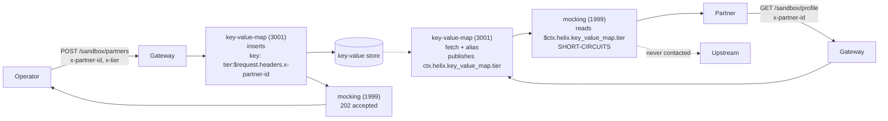

# Solution 12 — Key-value store: a sandbox that answers every partner with its own values

**One route, no backend, and a different answer for every caller. Onboarding a
partner is a request; changing their data is a request. Neither is a deploy.**

| | |
|---|---|
| **Problem** | *"Every partner gets the same canned response from our sandbox, so nobody catches an integration bug until production."* |
| **Business need** | A sandbox that differs per partner, changed by a write rather than a release |
| **Plugins** | `key-value-map` (inserts · fetch · alias) · `mocking` · `request-id` · `cors` |
| **Needs** | A gateway environment with the key-value store provisioned. No backend service, no crypto, no Enterprise plan |
| **Changes to your backend** | **None.** There is no backend. `mocking` short-circuits every route here |
| **Setup** | 🟢 single API, ~15 min |

---

## The problem

A partner sandbox that returns the same fixture to everyone is a sandbox that
only tests your happy path. The partner on a legacy settlement account, the one
on a tier with different limits, the one whose id has an unusual shape — none of
them finds out until production, because the sandbox told all three the same
thing.

The usual fix is to make the sandbox dynamic, which means standing up a service:
a small app, a datastore, a deploy pipeline, a place for it to break at 2am. For
something that exists only so partners can integrate against it, that is a lot of
operational surface. So most teams do the other thing — they keep the canned
response and absorb the integration bugs.

## Business need

The thirty-second version: [`business-need.md`](business-need.md).

| Dimension | A fixed sandbox fixture | Values in the gateway's store |
|---|---|---|
| **What each partner sees** | The same response as everyone | Its own values |
| **Adding a partner** | A code change, a review, a deploy | One request, by an operator |
| **Correcting a value** | The same, so in practice the wrong fixture stays | The same request again, effective on the next call |
| **A service to run** | An app, a datastore, a pipeline, a pager | None; the gateway answers |
| **"What does the sandbox think my tier is?"** | Read the fixture in a repository | Call one endpoint as that partner |

The fixture is a decision made once, early, that quietly became the definition of
"working". A partner whose settlement account has a different shape integrates
against it and fails in production; a partner on a different tier writes client
code that assumes the fixture's. The sandbox said yes, so nobody looked again.

What this does **not** buy you:

- **A backend.** `mocking` short-circuits the request, so a stored value can be
  *shown* to a caller but never forwarded to a real service. That is
  [solution 14](../14-per-partner-pgp-keys/).
- **A data store with guarantees.** Values carry a TTL, and there is no schema,
  versioning or audit trail. Right for a sandbox, wrong for anything else.
- **Security by default.** The registration route ships unauthenticated, and every
  stored value is readable by anyone who sends the matching partner id.
- **Validation of what partners send.** It changes what the sandbox *answers*, not
  what it accepts.

No ROI figure is claimed anywhere in this package.

## What this does instead

Values live in the gateway's key-value store. An administrative route writes
them, keyed by the partner's own id. A read route fetches whatever the calling
partner's id points at and answers with it. `mocking` composes the response, so
nothing is proxied anywhere.

Adding a partner is a POST. Changing a partner's data is the same POST again.
Neither touches a revision, a route, or a deploy.



The store outranks the mock — `key-value-map` is priority 3001 and `mocking` is
1999, both in the access phase — so by the time the mock builds its response the
values are already in the request context. Reverse that and every value is empty,
with nothing to tell you why.

## The one thing to get right: there are two substitution grammars

This is the whole solution, and getting it wrong fails **silently** — a 200, an
empty string, and nothing in any log.

| Form | What it does | Reads a stored value? |
|---|---|---|
| `${ctx.helix.<ns>.<field>}` | Looks the **whole dotted string** up as one variable *name* in a flat table. Only `service-callout` ever writes to that table. | **No.** Always empty here. |
| `$ctx.<dotted.path>` | Bare `$`, no braces. **Walks the request context** segment by segment, so it reaches anything actually present. | **Yes.** |

`key-value-map` publishes into `ctx.helix.key_value_map` all along. The second
form reaches it; the first cannot. On this build **only `mocking` resolves the
second form** — in `response_example` *and* `response_headers`.

The package ships a `/sandbox/diagnostics` route that prints the same value in
both grammars, so a team learning this can see the difference rather than read
about it:

```
bare_form   = platinum
brace_form  =
namespace   = {"tier":"platinum"}
```

`example/verify.sh` asserts that the brace form stays empty. If it ever starts
resolving, this package's explanation is wrong and its guidance should change.

**Drop `/sandbox/diagnostics` before production.** It's a teaching aid — it
exposes the substitution grammar and the namespace's contents, which is exactly
what you don't want a caller to see once this is live.

### Where values land

```
fetched   ->  ctx.helix.<ctx_namespace>.<key>           flat
inserted  ->  ctx.helix.<ctx_namespace>.inserted.<key>  one level down
```

The default `ctx_namespace` is `key_value_map`. That asymmetry between fetched
and inserted is real, and it is why the registration route and the read route
reference their values differently.

## Why `alias` is load-bearing

The fetch key here is **dynamic** — `tier:$request.headers.x-partner-id`. Without
an alias, the value would publish under a field named after whatever the caller
sent (`tier:acme-42`), and no static template could name it.

`alias` **renames the published field** to a name you choose:

```yaml
key-value-map:
  fetch:
    keys:
      - key: "tier:$request.headers.x-partner-id"
        alias: tier          # -> $ctx.helix.key_value_map.tier
```

That single line is what turns "a store" into "a per-caller store". It is the
difference between this solution and a slightly fancier static mock.

## Build it with the Helix Agent

Recommended path, about fifteen minutes. The whole build is **one prompt**:
[`helix-agent-prompt.md`](helix-agent-prompt.md). Paste it as a single message and
replace the `{{...}}` values. Then run [`example/verify.sh`](example/verify.sh)
against it, as under [What the caller sees](#what-the-caller-sees). Its sixth check needs the
`/sandbox/diagnostics` teaching route, which the prompt does not build; the first
five cover the agent's build. [AGENT-GUIDE.md](../../AGENT-GUIDE.md) carries the
standing rules the prompt assumes.

> **Check what was stored, not what the agent said.** Read the revision back. The
> registration route should carry `key-value-map` `inserts` keyed per partner
> (`tier:$request.headers.x-partner-id`, `settlement:…`) and `mocking` answering
> 202. The profile route should carry a `fetch` of the same keys **with an
> `alias` on each**, and `mocking` reading `$ctx.helix.key_value_map.<alias>`:
> **bare `$`, no braces**. `${ctx.helix…}` resolves to empty, with a 200. Both
> plugins should sit under their own names in each route's `plugins` map.

### Why the prompt is worded the way it is

It is written the way a platform user would ask: which routes, what each stores
or answers, and that partners are isolated. It names no plugin, no grammar and no
field. Two sentences carry the guards:

- **"Each partner sees only its own values"**, and the per-partner key in the
  first bullet. That is the dynamic key plus `alias`. Without an alias, the
  fetched value publishes under a name that changes with every caller, and no
  response template can name it. See [why `alias` is load-bearing](#why-alias-is-load-bearing).
- **"The gateway answers both itself"**. That is `mocking`, which short-circuits.
  The upstream is still bound, because a revision won't deploy without one.

What the wording leaves to the agent is [the one thing to get
right](#the-one-thing-to-get-right-there-are-two-substitution-grammars): the
response must read the store with the bare `$ctx.` form. Earlier versions of this
package handed the agent the exact route config, four steps of it. This one
doesn't, so the check above is where you catch a braced reference. The
`/sandbox/diagnostics` route in the spec exists to show that difference; the prompt
leaves it out, as a normal sandbox wouldn't have it.

What the prompt no longer carries: the four-step split, the literal plugin blocks,
`fail_action`, the `tier:` key prefix, `alias`, and the warnings about braces,
hyphens and the plugin-name level. See [Validation status](#validation-status) for
how it ran.

## Variations

Follow-ups for the same session, once the build above is standing. Use the same
register as the prompt and say what you want to be true.

**Protect the registration route**
```text
Require an operator's API key in the X-Admin-Key header on POST /sandbox/partners
only, and leave the profile route as it is. Tell me what is still open after that.
```
That is [08](../08-api-key/).

**Store another value per partner**
```text
Also store each partner's X-Region header, and return it as "region" in the
profile response.
```

**Show the store's contents while my team learns it**
```text
Add GET /sandbox/diagnostics, answered by the gateway, showing the calling
partner's stored tier read two ways: as $ctx.helix.key_value_map.tier and as
${ctx.helix.key_value_map.tier}, plus everything stored for that partner. I'll
remove it before production.
```

**Key on the caller's identity instead of a header**
```text
X-Partner-Id is a header anyone can send. Identify the calling app instead, and key
the stored values on that app, so a partner can only ever read its own.
```

## When the agent goes wrong

**Read the stored revision before you trust any of it.** Every row below returns
a 200.

| Symptom | Cause |
|---|---|
| The agent writes a design, creates nothing, and says live execution is off | It read per-partner stored values as backend logic (seen 2026-10-14). Start a new session and say the values live in the gateway's key-value store and the gateway answers with `mocking`, or import the spec. |
| Values come back as empty strings | The response reads `${ctx.helix…}` with braces. That form reads a different table the store never writes to. Use the bare `$ctx.` form. |
| Every partner sees the same value, or none | The fetch has no `alias`, or the key lost its per-partner part. |
| The reference resolves partly, leaving a literal tail | A hyphen in a `$ctx` path ends it. Use underscores. |
| A header shows up as mangled text like `-partner-id` | `$request.headers.<name>` is the store's grammar and doesn't resolve in `mocking`. Use `$http_x_partner_id`. |
| The response is invalid JSON | A `$ctx` reference to a whole table expands to a JSON object; don't quote it. |
| The route deploys with plugins you never asked for | The plugin-name level was dropped, and one plugin's fields were promoted into the `plugins` map. |
| `stream closed with reason: error`, nothing written | Malformed tool arguments on a large route write. Seen on an older agent model. Retry once, then import [`example/api-spec.yaml`](example/api-spec.yaml). |

## Install it directly

```bash
# import the spec (multipart — a raw application/yaml body is rejected with 415)
curl -X POST "$CP/api/orgs/$ORG/apis/from-spec" \
  -H "authorization: Bearer $TOKEN" \
  -F "file=@example/api-spec.yaml"

# bind an upstream and deploy. The upstream is never contacted — mocking
# short-circuits — but the binding is required for the revision to deploy.
```

Then prove it:

```bash
GATEWAY=https://<YOUR_GATEWAY_HOST> ./example/verify.sh
```

## What the caller sees

```bash
# register two partners
curl -X POST "$GW/sandbox/partners" \
  -H 'x-partner-id: acme-42' -H 'x-tier: gold' -H 'x-settlement-account: GB29-SANDBOX-0001'
# {"registered":true,"stored":{"tier:acme-42":"gold","settlement:acme-42":"GB29-SANDBOX-0001"}}

# each one reads its own
curl "$GW/sandbox/profile" -H 'x-partner-id: acme-42'
# {"partner":"acme-42","tier":"gold","settlement":"GB29-SANDBOX-0001"}

curl "$GW/sandbox/profile" -H 'x-partner-id: globex-7'
# {"partner":"globex-7","tier":"bronze","settlement":"GB29-SANDBOX-0002"}

# change one, with no deploy
curl -X POST "$GW/sandbox/partners" \
  -H 'x-partner-id: acme-42' -H 'x-tier: platinum' -H 'x-settlement-account: GB29-SANDBOX-0009'
curl "$GW/sandbox/profile" -H 'x-partner-id: acme-42'
# {"partner":"acme-42","tier":"platinum","settlement":"GB29-SANDBOX-0009"}
```

## Gotchas

These are the four that cost time when this package was built and tested. Each is
silent — every one of them returns a 200.

**`$request.headers.<name>` does not work inside `mocking`.** It is
`key-value-map`'s key/value grammar. Put it in a `response_example` and you get
mangled output rather than an error — testing produced the literal `-partner-id`.
Inside `mocking`, the forms that resolve are `$ctx.<path>` and ordinary gateway
variables such as `$http_x_partner_id`.

**A ctx reference to a table expands to a JSON object.** So it must not sit
inside quotes in a JSON body. `"stored":"$ctx.helix.key_value_map.inserted"`
produces structurally invalid JSON, returned with a 200.

**You cannot suffix a reference with a dot.** Everything after `headers.` is
taken as the header name, so `$request.headers.x-partner-id.tier` looks up a
header literally named `x-partner-id.tier` and finds nothing. Put the
discriminator in front — `tier:$request.headers.x-partner-id` — separated by a
character outside `[A-Za-z0-9_-]`.

**Hyphens end a `$ctx` reference.** Its segments are `[A-Za-z0-9_]` only, so
`$ctx.helix.key_value_map.partner-tier` resolves the part before the hyphen and
passes `-tier` through as a literal. Note this differs from `key-value-map`'s own
key grammar, which *does* accept hyphens. Underscores only in `$ctx` paths.

## When to use this, and when not to

**Use it** for partner and developer sandboxes, per-tenant demo environments,
contract-test doubles that must differ per consumer, and any stub whose data
changes more often than your release train.

**Don't use it** when the stored value has to reach a real backend. `mocking`
short-circuits, so it can show a value but never forward one. That job needs
`pgp-crypto` or `lua-callout` — see
[solution 14](../14-per-partner-pgp-keys/). And don't use it for anything confidential:
every value is readable by anyone who can send the right partner id, which is a
header.

## Limitations

- **The registration route ships unauthenticated.** Anyone who can reach it can
  rewrite any partner's values. Protect it before exposing it.
- **A miss and a stored empty string are indistinguishable.** Both render as `""`.
  Store a sentinel if you need to tell them apart.
- **`fail_action: close` governs store errors, not misses.** An unknown partner
  gets a 200 with empty values; nothing here fails closed.
- **The 202 is not proof of a write.** It acknowledges that the insert was
  configured. Read the value back to confirm one.
- **Values expire.** A partner left alone past the TTL silently reverts to the
  unregistered response.
- **No schema, no audit trail.** This is a sandbox pattern, not a data store.

Full list: [`solution.yaml`](solution.yaml) § `limitations`.

## Validation status

- **Locally validated** — structure, plugin fields against the live schema,
  reference and alias agreement, ordering.
- **Gateway dry-run passed** — the spec imports and dry-runs clean.
- **Gateway deployed** — deployed ACTIVE to a test environment to run the tests.
- **Functional test passed** — `example/verify.sh` 6/6, including partner
  isolation, a store miss, a change with no deploy, and the grammar guard.
- **Agent-mode run: FAIL, built nothing** (2026-10-14, `tencent/hy3`, the prompt as
  shipped). The agent treated per-partner stored values as backend logic it could
  not run, designed rate limiting and log masking with no key-value store and no
  `mocking`, and wrote a design without creating an API. The spec-import path
  above is unaffected. Until the agent can reach the store from a plain request,
  import [`example/api-spec.yaml`](example/api-spec.yaml), or tell the agent to use
  the gateway's key-value store and answer with `mocking`.
