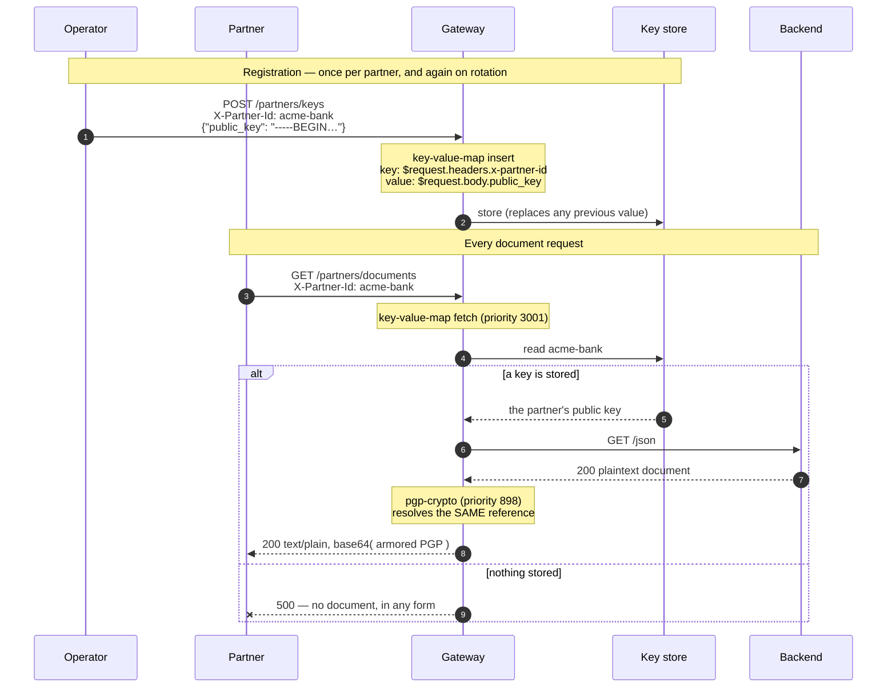

# Solution 14 — Per-partner PGP keys: one route, fourteen partners, and rotation without a deploy

**Key material in a route is fine until the second counterparty. This fetches the
key per request instead, so adding a partner is a write and rotating one is a
write — neither is a release.**

| | |
|---|---|
| **Setup time** | ~20 minutes |
| **Difficulty** | 🟡 Intermediate — two plugins, and a write path you have to protect |
| **Needs** | A fresh org (its default **test** environment) and an OpenPGP public key to register. **Nothing to fill in** — no key material appears in this spec, which is the point. |
| **Plugins** | `key-value-map` (insert + fetch) · `pgp-crypto` · `proxy-rewrite` · `request-id` |
| **Build it with** | 🤖 **[the Helix Agent](helix-agent-prompt.md)** — recommended · or import [`example/api-spec.yaml`](example/api-spec.yaml) |
| **Assets** | ✅ [Agent prompt](helix-agent-prompt.md) · ✅ [Architecture](architecture.md) · ✅ [Business need](business-need.md) · ✅ [Spec](example/) · ✅ [Tests](tests/) · ✅ [Manifest](solution.yaml) |

---

## What this package is about

**Two earlier packages, combined for one job.** [Solution 12](../12-key-value-store/)
is the gateway's key-value store: seeding a per-caller value, resolving it from
something on the request, and replacing it without a deploy.
[Solution 13](../13-pgp-encryption/) is PGP at the edge, with the key in the route.
This package keeps each partner's PGP key in the store, so one route serves every
partner and a rotation is a write. Read 12 for the store and 13 for the crypto;
this README assumes both and covers what the combination adds.

Why the store needs a consumer like PGP here: **observing** a stored value and
**using** one are different jobs. 12's `mocking` observes one, reading
`ctx.helix.key_value_map` directly, but it short-circuits the request, so it can
never put a stored value into a call that reaches your backend. This package *uses*
one on a real proxied response, and for that the consumer set is narrower:
`pgp-crypto` and `lua-callout` are the only plugins that resolve a store reference
themselves. `lua-callout` carries `enterpriseOnly: true` and is refused at import
**on a free-trial organisation**, which is why this package is built on
`pgp-crypto` and runs anywhere. Off a free trial, `lua-callout` imports and deploys
and becomes a second option; test the import rather than trusting the catalogue
flag, which does not change.

The one difference from 13, in a line: **13 writes the key into the route; this
fetches it per request.**

| | [13 — PGP encryption](../13-pgp-encryption/) | **This one** |
|---|---|---|
| Key location | A literal in the route configuration | An entry in a store, fetched per request |
| Adding a counterparty | A new route, a new key in a document | A write |
| Rotating a key | Edit the route, deploy a revision, hard cutover | A write |
| Key material in git | Possible, and the package warns about it | Nothing to leak — no key is in the spec |
| Complexity | One plugin | Two, plus a registration path you must protect |

Use 13 for one long-lived integration. Come here at the second one — and ideally
before, because migrating N routes later is worse than starting here.

## The problem

> *"We started with one settlement partner, so the key went in the route. We're at
> fourteen now. That's fourteen routes that are identical except for a key, every
> one of those keys is in a configuration document somebody could commit, and when
> a partner rotates — which they do, on their schedule, not ours — it's a change
> request, a review and a deploy. Last month one of them rotated on a Friday
> afternoon and we found out because their file started failing."*

Three costs, and they all scale with the number of counterparties:

1. **N routes that differ by one field**, so any change to the *shape* is N edits.
2. **N keys inside configuration**, each one a thing that can end up in a
   repository.
3. **Rotation is a release**, on the counterparty's timetable rather than yours —
   and on a single route the old and new keys cannot both be live, so it is a hard
   cutover that has to be coordinated.

## Business need

The thirty-second version: [`business-need.md`](business-need.md).

| Dimension | A key in every route | Keys in the gateway's store |
|---|---|---|
| **Routes** | One per counterparty | One for all of them |
| **Key material in configuration** | In every document you import and every revision you read back | None |
| **Adding a counterparty** | A new route, a review, a deploy | A write |
| **Rotation** | A release, as a hard cutover, on the partner's timetable | A write, effective on the next request |
| **A change to the route's shape** | N edits, and the Nth gets missed | One edit |

What it costs, and two of these are enough to decide against it for a single
integration:

- **A write path you have to protect.** There is no control-plane API for these
  entries on this build, so the only way in is a route. That route writes key
  material, so it is administrative. An unauthenticated write to your key store is
  worse than a key in a configuration document.
- **A second moving part.** Two plugins, a store, and a reference grammar that
  fails silently when it is wrong. `header` instead of `headers` produces no error
  anywhere and looks exactly like "no key registered".

The crossover is the second counterparty. Starting here when you can see one coming
is less work than migrating N routes later.

What this does **not** buy you:

- **Access control.** The partner id arrives in a header the caller controls. Any
  caller can request any partner's document. They receive something encrypted to
  that partner's key and cannot read it, which is a reason not to panic, not a
  reason to call it authorization.
- **Key history.** Registration replaces the entry. There is no versioning, and a
  bad write destroys the previous value.
- **Validation of what you store.** A wrong key is accepted, and found only when a
  counterparty cannot read a document. See
  [a registered key can be unusable](#a-registered-key-can-be-unusable-and-the-status-will-not-tell-you).

No ROI figure is claimed anywhere in this package.

## How a request flows



## The reference grammar is the whole mechanism

`key-value-map` resolves templates, and `pgp-crypto` resolves the *same* templates
against the namespace it wrote:

```
$request.headers.<name>    $request.query.<name>    $request.body.<dotted.path>
$response.headers.<name>   $response.body.<dotted.path>
$consumer.<suffix>         →  "<consumer_name>.<suffix>"
$ctx.<path>                walks the request context
```

Two things to know before you write one:

- **It is `headers`, plural.** `$request.header.x-partner-id` resolves to nothing,
  silently. The only symptom is the consuming plugin failing — which looks
  identical to "no key registered".
- **The fetch and the consumer must use the same template.** On the read route
  below, `$request.headers.x-partner-id` appears twice: once to decide what to
  fetch, once to decide what to read. They agree because they are the same string.

## Configuration

Source of truth: [`example/api-spec.yaml`](example/api-spec.yaml).

Registration — the value comes from the **request body**, never from this file:

```yaml
key-value-map:
  fail_action: close
  inserts:
    - key: "$request.headers.x-partner-id"
      value: "$request.body.public_key"
```

Use — fetch, then let the crypto plugin resolve the same reference:

```yaml
key-value-map:
  fail_action: close
  fetch:
    keys:
      - key: "$request.headers.x-partner-id"

pgp-crypto:
  keys_ctx_namespace: key_value_map
  encrypt:
    target: response
    source: body
    public_key: "$request.headers.x-partner-id"
    fail_policy: fail-close
    fail_close_status: 500
```

**A missing entry is not an error to `key-value-map`.** It does not know whether
the value mattered. The failure is raised by the *consuming* plugin — so
`fail_policy` on `pgp-crypto` is the control that decides what an unregistered
partner gets, and `fail-open` there would return the backend's document **in the
clear**. One of the tests asserts the 500 for exactly that reason.

## Four things this does not fix

Stated up front, because two of them are load-bearing.

**There is no control-plane API for these entries on this build.** The only write
path is the plugin's own `inserts`, which is why a registration route exists at
all. That is a real constraint, not a design preference.

**On a free-trial organisation you cannot swap the consumer for an *injecting*
one.** `lua-callout` — the obvious choice if you wanted to inject a stored value
as an upstream header and skip crypto entirely — is the one gated plugin on this
build, and import returns `403 Plugin 'lua-callout' is available on Enterprise
plans only ... cannot be attached on a free trial organization`. Off free trial
it imports and deploys, and the store half of this package is unchanged either
way. If you try it, note its priority is **0**: put it on a route with a
short-circuiting plugin such as `mocking` (1999) and it never runs, returning an
empty value with no error. Raise it with `_meta.priority`.

This is narrower than it sounds, and the boundary is worth knowing: **reading** a
stored value needs neither. `mocking` resolves `$ctx.helix.key_value_map.<key>`
on any plan — see [solution 12](../12-key-value-store/) — it simply short-circuits
the request, so what it cannot do is hand the value to your backend.

**The registration route is administrative, and ships unauthenticated.** Every
package in this library ships with the behaviour under test and nothing else — so
as it stands, anybody who can reach that route can register *their* key under
*any* partner id, and that partner's documents are then encrypted to them. Put
[solution 08](../08-api-key/) in front of it and restrict it to operators before
this exists anywhere real. The test plan carries that as a written case rather
than a warning, because tests get read.

**The partner id comes from a header the caller controls.** As shipped, any caller
can ask for any partner's document — they receive something encrypted to that
partner's key and cannot read it, which is a reason not to panic and *not* a reason
to call it access control. Bind the id to an authenticated identity: `helix-auth`
resolves the calling app, and `$consumer.<suffix>` exists in the grammar precisely
so the key can be keyed on that instead of on a header.

## Build it with the Helix Agent

Recommended path, about twenty minutes. The whole build is **one prompt**:
[`helix-agent-prompt.md`](helix-agent-prompt.md). Paste it as a single message and
replace the `{{...}}` values. Then register a key and run
[`example/verify.sh`](example/verify.sh) against it, as under [Testing](#testing).
[AGENT-GUIDE.md](../../AGENT-GUIDE.md) carries the standing rules the prompt
assumes.

> **Check what was stored, not what the agent said.** Read the revision back. The
> registration route should carry `key-value-map` with an `inserts` entry whose key
> is `$request.headers.x-partner-id` and whose value is `$request.body.public_key`.
> The document route should carry a `key-value-map` `fetch` of the same key, and
> `pgp-crypto` with its settings **under `encrypt`**, `fail_policy: fail-close`, and
> a `public_key` that points at what the fetch stored: either the same reference,
> or `$ctx.helix.key_value_map.<alias>` when the fetch names an alias. A literal
> value anywhere a reference belongs serves one partner forever.

### Why the prompt is worded the way it is

It names no plugin. It describes the store and the encryption, and names the two
things earlier runs got wrong in prose:

- **"`$request.headers.x-partner-id`, written exactly that way … left for the
  gateway to resolve."** The reference grammar is the whole mechanism, and the
  schema does not teach it. An agent that treats the reference as a placeholder
  substitutes a value, and the route then serves one partner. `headers` is plural;
  the singular resolves to nothing, silently.
- **"The encryption settings sit under `encrypt`."** Asked in prose, an earlier
  agent wrote `pgp-crypto` flat, which the schema rejects.
- **"Never the document in the clear."** That is `fail_policy: fail-close` on
  `pgp-crypto`. A missing entry is not an error to the store; the consuming plugin
  decides, and `fail-open` there returns the backend's document unencrypted.

What the prompt no longer carries: the two literal route objects; the plugin and
field names; `request-id`; the `plugins`-map and `x-helix-gateway` instructions;
and the two-step split. On 2026-10-13, on `tencent/hy3`, the agent built both
routes in one session, and `verify.sh` passed all seven checks, including
decryption and rotation. See [Validation status](#validation-status).

### What the agent decides for you

| | The prompt says | This package's spec | The 2026-10-13 run |
|---|---|---|---|
| How `pgp-crypto` finds the key | the same reference, everywhere | `public_key: "$request.headers.x-partner-id"` | the fetch names an alias, and `public_key: "$ctx.helix.key_value_map.partner_public_key"`. Both work |
| The stored value at rest | nothing | plain | `encrypt: true` on the insert (the store encrypts it; the fetch decrypts it) |
| `fail_action` on the store | nothing | `close` | not set |
| Fail-close message | a 500 | `no usable key is registered for this partner` | the plugin's default, `failed to encrypt response` |
| Correlation id | nothing | `request-id`, API-wide | `request-id`, API-wide |

None of these decides whether a partner gets its own key. The reference on both
sides of the store, and `fail-close`, do.

## Variations

Follow-ups for the same session, once the build above is standing. Use the same
register as the prompt and say what you want to be true.

**Protect the registration route** *(do this before anything else)*
```text
Require an operator's API key in the X-Admin-Key header on the key registration
route only. Leave the document route as it is, and tell me what is still open
after that change.
```
That is [08](../08-api-key/).

**Key on the authenticated caller instead of a header**
```text
The partner id currently comes from a header the caller controls. Identify the
calling app on the document route, and key the stored entry on that app instead of
on X-Partner-Id. Explain what that changes about who can request what.
```

**Store something other than a key**
```text
I also want a per-partner upstream path stored alongside the key. Show me how to
fetch two entries on one route, and how a second plugin would read the other one.
```

**Go back to the simple shape**
```text
I only have one counterparty after all. Show me this with the key in the route
instead, and be explicit about what I lose and what I stop having to protect.
```
That is [13](../13-pgp-encryption/).

## When the agent goes wrong

**Read the stored revision before you trust any of it.**

| Symptom | Cause |
|---|---|
| Every partner gets the fail-close error | The reference resolves to nothing. Check `headers` plural, that the client sends the id header, and that `pgp-crypto` points at what the fetch stored (the same reference, or the fetch's alias). |
| One partner works and the rest fail | A fixed string was written where a reference belongs. |
| The agent substitutes a value for `$request.headers.x-partner-id` | Reply: leave the reference as written; the gateway resolves it on each request. |
| The schema rejects `pgp-crypto` | It was written flat. The crypto settings are nested under `encrypt`. |
| The document comes back readable | `fail_policy` is `fail-open` on `pgp-crypto`, which returns the backend's document in the clear. |
| A registered partner gets **200 with an error message in the body** | The stored key has no encryption subkey: what `gpg --quick-generate-key` produces. See [above](#a-registered-key-can-be-unusable-and-the-status-will-not-tell-you). |
| `stream closed with reason: error` after a route write | Malformed tool arguments; nothing was written. Seen on an older model with large route writes. Retry once, then import [`example/api-spec.yaml`](example/api-spec.yaml). |
| The routes exist with **no plugins**, at exit 0 | The agent wrapped them in `x-helix-gateway` inside the live route object, which a live route silently discards. |
| Deploy fails: `Only INACTIVE revisions can be updated` | Clone the revision or undeploy, then apply. |

## Install it directly

```bash
export ORG=<ORG_ID>
export TOKEN=<control-plane bearer token>      # short-lived
export BASE=https://<YOUR_GATEWAY_HOST>/api

# 1. Import example/api-spec.yaml. Nothing in it needs filling in — that is the point.
# 2. Bind your backend as the upstream and deploy the revision to "test".
# 3. Put authentication in front of /partners/keys before anyone else can reach it.
# 4. Register a partner's key, then prove it:
GATEWAY=https://<YOUR_GATEWAY_HOST> \
PUBLIC_KEY_FILE=./partner-a-public.asc GNUPGHOME=~/.gnupg-partner-a \
SECOND_PUBLIC_KEY_FILE=./partner-a-rotated.asc SECOND_GNUPGHOME=~/.gnupg-partner-a2 \
./example/verify.sh
```

## Testing

Exit 0 means all of these held:

| # | Case | Expected |
|---|---|---|
| 1 | **A partner with no registered key** | `500` — and **no document**, in any form |
| 2 | Registering a key | `200` — **but read it back**; see the gotchas |
| 3 | That partner's document | `200`, base64 of armor |
| 4 | **A different, unregistered partner** | still `500` — entries are per partner |
| 5 | Decrypting with that partner's key | succeeds |
| 6 | **Re-registering, then fetching again** | the **new** key decrypts it; the old one cannot |

**Case 1 is the security case** — a 200 there means the document went out in the
clear. **Case 6 is the whole solution**: rotation with no revision, no route change
and no deploy, asserted rather than claimed.

Cases 1-4 need only bash, curl, base64 and a public key, so they run in a pipeline
that holds no private key material.

## A registered key can be unusable, and the status will not tell you

The sharpest edge in this package, found by running it.

| Partner id | Status | Body |
|---|---|---|
| never registered | **500** | `{"message":"no usable key is registered for this partner"}` |
| registered with a **sign-only** key | **200** | *identical body* |
| registered with a usable key | **200** | base64 PGP |

`fail_close_status` fires only on a store **miss**. When the store returns a value
the crypto cannot use, the failure goes out as a **success**, with the error
message in the body. Neither the status nor the message distinguishes "wrong kind
of key" from "no key".

**This is the ordinary case, not an edge case.** `gpg --quick-generate-key` — what
almost everyone reaches for — produces a primary key with **no encryption
subkey**, and adding `default never` does not change that. A partner following the
obvious path sends you a signing key, and you store it happily.

Check before you register, and put this in the note you send them:

```bash
gpg --list-keys --with-colons "$UID" | awk -F: '/^(pub|sub)/{print $1, $12}'
# want:  pub scESC        e = encrypt, s = sign, c = certify
#        sub e            no `sub e` row means the route cannot encrypt to it
```

Repair an existing key rather than regenerating it:

```bash
FPR=$(gpg --list-keys --with-colons "$UID" | awk -F: '/^fpr/{print $10; exit}')
gpg --quick-add-key "$FPR" rsa3072 encr never
```

Then **re-register** — the stored copy is still the broken one until you overwrite
it.

**For your tests: assert on the body, never on the status.** A check for `200`
passes while the caller receives no document at all.

## Gotchas

- **`headers` is plural.** `$request.header.x` resolves to nothing, silently.
- **The fetch and the consumer must use the same template**, or the crypto plugin
  looks for an entry the fetch never stored.
- **`keys_ctx_namespace` must match `key-value-map`'s `ctx_namespace`.** Both are
  left at the default here so they agree by construction; change one and you must
  change the other.
- **A KVM miss is not an error.** The consuming plugin's `fail_policy` decides what
  happens, and `fail-open` there returns the document in the clear.
- **There is no management API for entries.** The registration route is the write
  path, and it is yours to protect.
- **Do not put a literal key in `inserts`.** That puts key material straight back
  into the configuration document, which is the thing this package exists to avoid.
- **Registration replaces, it does not append.** Which is what makes rotation work —
  and means a bad write destroys the previous value.
- **Storing the wrong key is invisible from the gateway.** Only a round-trip
  decrypt finds it.
- **A registered-but-unusable key returns 200 with the error body.** See the
  section above. Assert on the body.
- **The registration route's status reflects the upstream echo, not the store
  write.** The insert happens in the access phase, before proxying — a 502 from the
  echo backend can accompany a successful write. Read the value back to confirm it.
- **Everything in [solution 13's](../13-pgp-encryption/) gotcha list still
  applies** — the wire format especially.

## When to use it

Use it when:

- You have more than one counterparty, or expect to.
- Key material must not live in configuration documents.
- Counterparties rotate on their own schedule and you do not want a release each
  time.
- Per-caller values other than keys need the same treatment — the store is generic;
  crypto keys are simply the case where getting it wrong is most expensive.

Don't use it when:

- **You have exactly one long-lived counterparty.** [Solution 13](../13-pgp-encryption/)
  is one plugin instead of two and there is less to protect.
- **The value is static configuration.** A per-request lookup of something that
  changes yearly is cost without benefit.
- **You cannot protect the registration path.** An unauthenticated write to your key
  store is worse than a key in a configuration document.
- **You need the answer from another service rather than a store** —
  [solution 11](../11-service-callout/).

## Limitations

- **No control-plane API for entries.** The plugin's `inserts` is the only write
  path on this build.
- **The registration route is administrative and ships unauthenticated.**
- **The partner id comes from a caller-controlled header** unless you bind it to an
  authenticated identity.
- **A miss is silent** at the store; the consumer decides what it means.
- **Registration replaces the entry**, so a bad write destroys the previous value
  and there is no history.
- **No versioning and no staged rollout** — the new key is live on the next request.
- **Storing the wrong key is undetectable** without a round-trip decrypt.
- **`$request.body.<path>` requires a JSON body** and reads it at request time.
- **A registered-but-unusable key returns 200 carrying the fail-close error body.**
  The configured `fail_close_status` applies only to a store miss, so status-only
  assertions pass while no document is returned.
- **The registration route's status reflects the upstream echo, not the store
  write**, so neither a 2xx nor a 5xx there is evidence about the value.
- **The *injecting* consumer cannot be swapped on a free-trial org.** `lua-callout`
  is the one plan-gated plugin on this build, which leaves `pgp-crypto` as the only
  way to put a stored value into a proxied call. Reading one back is unrestricted —
  `mocking` does it on any plan ([solution 12](../12-key-value-store/)).
- **Entries are stored encrypted at rest and scoped per environment**, which says
  nothing about how the value reached the gateway.
- **Everything in [solution 13's](../13-pgp-encryption/) limitations still applies.**

Full list: [`solution.yaml`](solution.yaml) § `limitations`.

## Validation status

**Validated against a gateway — imported, dry-run, deployed, and exercised.**

| Stage | Status | Provenance |
|---|---|---|
| Configuration generated | **YES** | [`example/api-spec.yaml`](example/api-spec.yaml) |
| Local validation | **PASS** | Structural review of the spec and tests |
| Gateway dry-run | **PASS** | Non-destructive, against a temporary import. |
| Gateway deployed | **DEPLOYED** | Revision ACTIVE in a test environment. |
| Functional tests | **PASS (7/7)** | Including rotation: re-registering changed which key the document was encrypted to, with no deploy, and the old key could no longer read it. |
| Agent-mode run | **PASS (config + 7/7 functional)**, 2026-10-13, `tencent/hy3` | The current prompt, run once. The registration route stored the insert keyed on `$request.headers.x-partner-id`; the document route fetched it under an alias and pointed `pgp-crypto` at `$ctx.helix.key_value_map.partner_public_key`, with its settings under `encrypt` and `fail-close`. `verify.sh` passed all seven checks against the agent-built routes, with two throwaway key pairs: unregistered partners refused, decryption with the partner's private key, and rotation to a second key with no deploy. The routes ran under an `/agentrun-12` prefix, because this package's reference API holds the bare paths in that environment |

Overall: **READY.** The store, the reference grammar and the rotation claim were
all exercised against a live gateway, not inferred from the schema.

## Related solutions

- **[13 — PGP encryption](../13-pgp-encryption/)** — the same crypto with the key
  written into the route. Go there if you want the crypto itself, or if you have
  exactly one counterparty.
- **[11 — Service callout](../11-service-callout/)** — when the per-request value
  comes from another service rather than a store.
- **[08 — API keys](../08-api-key/)** — what belongs in front of the registration
  route, and how to key entries on an authenticated identity instead of a header.
