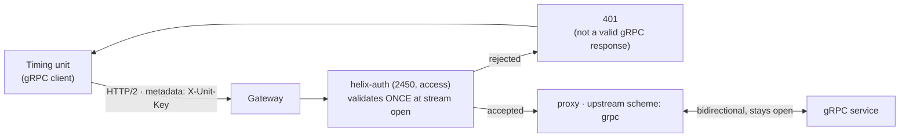

# Solution 15 — A bidirectional gRPC stream, authenticated at the edge

**Put the gateway in front of a streaming gRPC service and it authenticates every
connection as it opens, without the service implementing auth at all. The stream
stays bidirectional and stays open.**

| | |
|---|---|
| **Problem** | *"Our units hold a gRPC stream open for hours. Anything that wants to authenticate or count them has to be built into the service."* |
| **Business need** | Identity and control at the edge for long-lived connections, without a service change |
| **Plugins** | `helix-auth` (validate · key-auth) · `request-id` · an upstream with `scheme: grpc` |
| **Needs** | A gRPC backend reachable from the gateway |
| **Changes to your service** | **None** |
| **Setup** | 🔴 the upstream is a separate control-plane object, and the path has to be checked first |

---

## The problem

A timing unit, a trading feed, a telemetry agent — anything that holds a gRPC
stream open for hours — is a connection your platform cannot see. Authentication,
identity, connection counts and per-caller limits all have to be built into the
service, because nothing in front of it can participate in a stream it does not
understand.

So every team that owns such a service builds its own auth, and every one of them
builds it slightly differently.

## Business need

The thirty-second version: [`business-need.md`](business-need.md).

| Dimension | Auth built into each streaming service | Auth at the edge |
|---|---|---|
| **Implementations** | One per service, each slightly different | One, on the gateway |
| **Who is connected** | Whatever each service chose to log | An app per stream, in the analytics you already run |
| **Cutting off one unit** | A code change in the service | Disable its credential; its next connection is refused |
| **Connection counts and lifetimes** | Built per service, if at all | `requests-count` and `response-time`, per app, with no extra config |
| **Service change to adopt** | — | None. The stream stays bidirectional and stays open |

The trade: the gateway checks a stream **once, as it opens**. That is what makes
it cheap enough to put in front of a connection that lasts hours. It is also why
a revoked key doesn't close a stream that is already open, and why a quota counts
streams rather than messages.

## What this does

The gateway terminates the client's HTTP/2 connection, authenticates the stream
as it opens, and proxies it to the backend over gRPC. The stream stays
bidirectional throughout. The service sees an ordinary gRPC connection and
implements nothing.



## The upstream is not in the spec

This package is shaped differently from every other one in the library, and it is
worth saying plainly: **`example/api-spec.yaml` is only half the configuration.**

OpenAPI has no way to express "this upstream speaks gRPC". That lives on the
upstream object in the control plane:

```bash
POST /api/orgs/{orgId}/envs/{envId}/upstreams
{
  "name": "timing-grpc",
  "specification": {
    "scheme": "grpc",                       # grpcs for a TLS backend
    "type": "roundrobin",
    "pass_host": "node",
    "nodes": [{"host": "<GRPC_UPSTREAM_HOST>", "port": <GRPC_UPSTREAM_PORT>,
               "weight": 1, "priority": 1}]
  }
}
```

Then bind that upstream to the revision and deploy. Import the document on its
own and you get routes that proxy over HTTP to a gRPC port, which fails in a way
that looks like a backend problem.

**A scheme change does not propagate to a deployed revision.** Editing the
upstream and redeploying is not enough — you must **undeploy and deploy again**.
Nothing warns you; the route simply keeps its old behaviour.

## One stream is one request

This is the single most important thing to understand before building on it.

Every access-phase plugin evaluates **exactly once, at stream initiation**. That
is precisely what makes "authenticate the connection" work — there is one
decision point, at the moment the unit connects.

It also means something that usually surprises people:

> **A product quota counts streams, not messages.** One connection carrying a
> million messages consumes **one** unit of quota.

Measured, not assumed: with a limit of 1, five messages on a single stream all
went through, and the *next* stream was rejected. If your commercial model
assumes per-message metering, it does not work here, and no configuration changes
that.

The same property has a security consequence: **a credential revoked while a
stream is open stays effective until that stream ends.** Nothing re-authenticates
mid-stream.

## Route paths are gRPC method paths

```yaml
paths:
  /timing.TimingUnit/Ping:      # /<package>.<Service>/<Method>
    post:                        # always POST
```

Not a convention — that is literally what a gRPC client puts on the wire.

Note that the gateway does **not** proxy the gRPC reflection service unless you
route it. Clients talking to the gateway cannot discover your schema, so ship
them a proto or a protoset.

## What a rejection looks like

Authentication works. The *error surface* does not, and your integrators will hit
it on day one:

```
no key    -> HTTP 401, content-type text/plain, {"message":"Missing API key in request"}
bad key   -> HTTP 401, {"message":"Invalid API key in request"}
```

A gateway rejection is an ordinary HTTP response, not a gRPC one, so a client
cannot render it as an auth failure. Depending on the library it surfaces as
`Unauthenticated` wrapped in a complaint about content-type, or as an opaque
transport error — either way the caller does not see "your key is missing".

Tell your integrators to check the HTTP status directly when a stream will not
open. That is why this package's two negative tests are plain `curl` calls.

## Build it with the Helix Agent

Recommended path, about fifteen minutes. The whole build is **one prompt**:
[`helix-agent-prompt.md`](helix-agent-prompt.md). Paste it as a single message and
replace the `{{...}}` values. Then run [`example/verify.sh`](example/verify.sh)
with the key it gives you, as under [Testing](#testing).
[AGENT-GUIDE.md](../../AGENT-GUIDE.md) carries the standing rules the prompt
assumes.

> **Check what was stored, not what the agent said.** Read the revision back.
> There should be **five** routes: the three methods, and **both**
> `/grpc.reflection.v1.ServerReflection/ServerReflectionInfo` and
> `/grpc.reflection.v1alpha.ServerReflection/ServerReflectionInfo`. The 2026-10-14
> build routed only `v1alpha`. Everything else worked, but `grpcurl list` failed
> with a 502, because a client asks for `v1` first and stops when nothing answers.
> Add the `v1` route by hand. The upstream bound to the API should have **`scheme:
> grpc`**. `helix-auth` (validate, key-auth) can sit API-wide or on each route;
> both are correct here. Note which header it reads the key from. The prompt
> doesn't name one, and the 2026-10-15 build chose `apikey`.

### Why the prompt is worded the way it is

It names no plugin, no upstream field and no header. It says what the
integration team knows about the service, and what must be true of a connection:

- **"Our gRPC service."** That is enough for the agent to create the upstream with
  `scheme: grpc`. Get the scheme wrong and every call fails before auth matters.
  The gRPC part of this design lives on the upstream, not on the routes. An
  earlier wording spelled out "plaintext gRPC, not HTTP, and not TLS"; the shorter
  one built a working upstream without it.
- **"Exactly as written."** The method paths contain a dot and are matched
  literally. Both builds stored them as given.
- **"Hold these streams open for hours."** The key is checked once, when a stream
  opens. That is what a revoked key can't reach; see
  [one stream is one request](#one-stream-is-one-request).
- **Step 3 asks for the product with the app.** An app subscribes to an API
  through a product; without one, every stream is refused.

Want the key in a particular header? Say so in step 2, for example *"in the
X-Unit-Key metadata"*. Otherwise the agent picks one.

**"Plus server reflection"** doesn't name the two versions, and that is why the
check above matters. Name them if you would rather not add one by hand:
*"route both the v1 and v1alpha server reflection methods"*.

### What the agent decides for you

| | The prompt says | This package's spec | The 2026-10-15 run |
|---|---|---|---|
| Key header | nothing | `X-Unit-Key` | `apikey` |
| Where `helix-auth` sits | nothing | on each route | not recorded |
| Reflection versions | "server reflection" | `v1` and `v1alpha` | both |
| Correlation id | nothing | `request-id`, API-wide | not recorded |
| Upstream | "our gRPC service" | a separate object, `scheme: grpc` | created by the agent; serves gRPC |

The reflection row and the key header change what a client has to do. Builds
have differed on reflection: see [Validation status](#validation-status).

## Variations

Follow-ups for the same session, once the build above is standing. Use the same
register as the prompt and say what you want to be true.

**Count connections per unit**
```text
Show me how many streams each app opened over the last {{time_window}}, and how
long the longest one stayed open.
```
See [measuring connections](#measuring-connections).

**Limit how many streams a unit opens**
```text
Each unit may open at most {{streams_per_day}} streams a day. Enforce that per
app, and tell me what a unit sees when it goes over.
```
The quota counts streams, not messages.

**The service moves to TLS**
```text
Our gRPC service now terminates TLS on port {{tls_port}}. Change the API to match
and tell me what has to be redeployed for it to take effect.
```
A scheme change on the upstream doesn't reach a deployed revision until it is
redeployed.

**Only some units may send commands**
```text
Only units in the "controllers" group may call /timing.TimingUnit/Commands. The
others can still Ping and stream Status. Tell me plainly whether the gateway can
decide that, and how.
```

## When the agent goes wrong

**Read the stored revision before you trust any of it.**

| Symptom | Cause |
|---|---|
| `grpcurl list` fails with a 502 or an HTTP 404, while calls with a descriptor work | Only one reflection version is routed (seen 2026-10-14, `v1alpha` only). Add `/grpc.reflection.v1.ServerReflection/ServerReflectionInfo`. |
| Every call fails with a transport error, even with a valid key | The upstream is `http` or `https`, not `grpc`; or a scheme change was made and the revision wasn't redeployed. |
| 404 on a method that is routed | The path was rewritten: a dropped dot, a changed case, or a leading segment added. gRPC method paths are matched exactly. |
| 403 with a valid key | The app isn't subscribed to a product that contains this API, or the product isn't deployed to the environment. |
| A stream without a key is accepted | `helix-auth` is missing from the routes and from the API-wide plugins. |
| A stream drops after a quiet period | The route's `timeout.read` is shorter than the gap between messages. Each upstream message re-arms it. |
| A revoked key's stream keeps running | Expected. Auth is evaluated when a stream opens; the next connection is refused. |
| Deploy fails: `Only INACTIVE revisions can be updated` | Clone the revision or undeploy, then apply. |

## Testing

```bash
GATEWAY=<your-gateway-host> \
UNIT_KEY=<app credential key> \
KEY_HEADER=<the header your build reads the key from> \
./example/verify.sh
```

`KEY_HEADER` defaults to `X-Unit-Key`, the spec's header. An agent build picks
its own unless the prompt names one.

No `.proto` file is needed — this package routes reflection, so the schema is
discovered over the connection.

Six checks: unauthenticated refused, invalid key refused, authenticated unary,
an authenticated bidirectional stream that completes with a `grpc-status`, a
held-open stream that still closes cleanly, and reflection resolving.

`HOLD_SECONDS` defaults to 20. Raise it past the longest idle gap you expect in
production and run it again before you commit to hours-long connections.

## Gotchas

**Route both reflection versions.** A client asks for `grpc.reflection.v1` first
and falls back to `v1alpha` — but only if the v1 attempt gets a clean gRPC
answer. Route v1alpha alone and the v1 call lands on no route, returns an HTTP
404 that is not valid gRPC, and the client stops there instead of falling back.
Both routes ship in the spec for exactly this reason.

**Never put a body-touching plugin on these routes.** `response-rewrite`,
`xml-to-json`, `request-validation`, `pgp-crypto` and `mocking` all assume a
request that ends. A stream does not.

**Unary first when debugging.** `Ping` is the cheapest proof that routing, the
`scheme: grpc` upstream and auth are all correct. Once it returns, anything still
failing is specific to streaming.

## Measuring connections

Because one stream is one request, the analytics you already have answers both
questions people ask about long-lived connections — **how many, and for how
long** — with no extra configuration.

```
POST /api/orgs/{orgId}/analytics/metrics/requests-count
POST /api/orgs/{orgId}/analytics/metrics/response-time     # aggregation: MAX
{ "dimensions": ["api_path"],                              # or ["app_name"]
  "filters": [{"column":"api_name","operator":"EQ","value":["<your api>"]}],
  "excludeTimeUnit": true }
```

**`requests-count` is your connection count** — one row per stream, broken down
by method or by app:

```
/timing.TimingUnit/Commands        1
/timing.TimingUnit/Status          2
/timing.TimingUnit/Ping            5
```

**`response-time` is the connection lifetime.** A stream held open for 25 seconds
reports ~24,000 ms. Grouped by `app_name` it tells you how long each caller held
its connections:

```
/timing.TimingUnit/Commands   24235      <- the held stream
/timing.TimingUnit/Ping           9      <- a unary call
```

Grouped by `app_name` instead of by method, the same traffic validated at 26
requests attributed to one app, with a 24521 ms max — multiple streams from one
caller aggregate under their app, which is the point of grouping this way.

The dimensions are the same ones every other API has: `app_name`, `developer`,
`product_name`, `api_path`, `route_name`, `response_status_code`. A streaming API
is a first-class citizen in the analytics you already run.

Read it at the moment it matters: a stream's row appears when the stream
**closes**, because that is when its duration becomes a fact. For counts of
connections open *right now*, `requests-count` over a recent window answers it
for every practical purpose.

## Limitations

- **The spec is half the configuration** — the gRPC upstream is a separate object.
- **Quota counts streams, not messages.**
- **Auth is evaluated once**, so revocation does not reach an open stream.
- **Gateway rejections are not valid gRPC responses.**
- **Route reflection explicitly** if you want clients to discover the schema —
  both versions.
- **A stream's telemetry lands when it closes**, which is when its duration is
  known.

Full list: [`solution.yaml`](solution.yaml) § `limitations`.

## Validation status

- **Locally validated** — structure, plugin fields against the live schema, route
  paths, both reflection versions, and the absence of body-touching plugins.
- **Gateway dry-run passed** — the spec imports and dry-runs clean.
- **Gateway deployed** — deployed ACTIVE against a real bidirectional gRPC service.
- **Functional test passed** — `example/verify.sh` **6/6** on two environments
  with different fronting infrastructure: both refusals at stream start, unary,
  a two-way stream, a held stream, and reflection with no descriptor file.
- **Connection telemetry confirmed** — one `requests-count` row per stream;
  `response-time` of 24,235 ms for a stream held ~25s.
- **Agent, current wording — PASS 6/6**, 2026-10-15, operator, production. Both
  reflection versions; key header `apikey`. An earlier build of the same wording
  in the operator's alpha environment routed only `v1alpha`, and streaming failed
  there because its load balancer doesn't pass HTTP/2 through to the gateway.
- **Agent, earlier wording — 5/6**, 2026-10-14, `tencent/hy3`. The wording that
  named the plaintext upstream and `X-Unit-Key`. Checks 1–5 passed; reflection
  failed, because only `v1alpha` was routed.
