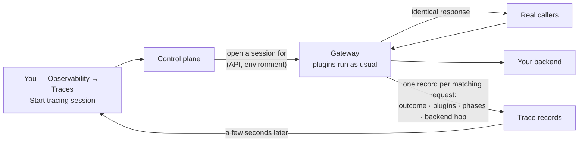

# Architecture — Request tracing

> [Overview](README.md) · [Business need](business-need.md) · **Architecture** · [Guides](guides.md) · [Agent prompt](helix-agent-prompt.md) · [Tests](tests.md) · [API reference](api-reference.md)

---

## What the gateway does here

Nothing different, and that is the point. A trace session does not change your
API's configuration or its responses. While a session is open, the gateway
also **writes down** what it did for each request, then carries on exactly as
before.

Tracing is not a plugin. You don't add it to the API spec, and you don't
redeploy to turn it on. You open a session on an API that is already deployed,
and close it (or let it expire) when you're done.

## The model

| Word | What it means |
|---|---|
| **Session** | A recording window on **one API in one environment**. It has a duration (1 minute to 1 hour) and records up to **10 requests** by default. One session per API per environment at a time. |
| **Record** | Everything about one request: what arrived, every plugin that ran, what reached the backend, what came back, and the timings. Shown as one row in the session. |
| **Filter** | An optional condition a request must meet to be recorded, such as `status >= 400` or a header your test sends. Checked **after** the response, so the status code can be used. |
| **Outcome** | A one-word verdict on each record, described below. |

Starting a session on an API that already has one open gives you **the open
one**, with its original duration and filter. To change either, stop it and
start again.

## How a request flows



Records arrive a few seconds after the request, not instantly. When scripting,
poll for them. Never wait once and assume.

## Reading a record: who answered?

This is the question a trace exists to settle. Two fields answer it:

| What the record shows | Who answered | What to do |
|---|---|---|
| Outcome **short circuit**, naming a plugin | **The gateway.** That plugin returned the response, and the backend was never called. | Look at that plugin's config and the request it received. |
| A **backend status** in the Upstream section, no short circuit | **Your backend.** The gateway passed its answer through. | Look at the **request as sent upstream**: headers, path and body after every plugin changed them. |
| Outcome **ok** | Nobody refused it. | Use the timings, if the complaint is speed. |

Every outcome the gateway records:

| Outcome | Meaning |
|---|---|
| `ok` | The request succeeded. |
| `short_circuit` | A plugin answered the request itself, such as a 400 from validation or a 401 from authentication. |
| `client_error` | The final status was 4xx and no plugin short-circuited it. In practice, the backend returned it. |
| `server_error` | The final status was 5xx. |
| `upstream_error` | The backend could not be reached, or failed, at the network level. |
| `plugin_error` | A plugin failed while it ran. |

A record also carries a list of **anomalies**, such as a short circuit, an error
status or a plugin that was expected but didn't run. In the UI these appear as
badges on the row.

## What a record contains

| Part | What you get |
|---|---|
| **Request** | Method, path, query, every header as received, and the body (if it fits; see below). |
| **Plugins, by phase** | For each plugin that ran: how long it took, its configuration, and a list of **changes**: headers added or replaced, variables set, the body before and after. |
| **Phase timeline** | Time spent in each stage: rewrite, access, before proxy, upstream, header filter, body filter, delayed body filter, log. |
| **Upstream** | The backend address, its status, connect time and response time. The request body as sent upstream. |
| **Response** | Status, headers, and the first few KB of the body. |

### Phases run in a fixed order

The gateway works through a request in stages, and plugins run in the stage
they belong to, highest priority first. The record lists them in the order they
actually ran:

```
rewrite → access → before proxy → upstream → header filter → body filter → log
```

A plugin that short-circuits stops the request moving forward. In the sample
API's 400, `request-validation` answers in the **rewrite** stage, so there is
no access stage, no upstream stage, and no backend status in the record. That
absence is the proof the backend was never called.

## What a trace does not show

- **Requests outside the session.** Nothing before you started it or after it
  ends. Tracing is for reproducing, not for looking back. For history, use
  analytics.
- **More than the cap.** After 10 recorded requests (the default, set by
  whoever runs your gateway), the session stops recording. It can still show
  as active until its duration runs out, so a session that stopped filling up
  is usually full, not broken.
- **Large bodies in full.** Response bodies are cut at about 4 KB, and very
  large request bodies are not recorded at all. The record says when either
  happened.
- **Anything redacted.** Headers are recorded exactly as sent, including
  `apikey`, `Authorization` and cookies. Anyone who can read traces in your org
  can read those values.
- **Other services.** A trace covers one hop: the gateway and its call to your
  backend. For tracing across your own services, use the `opentelemetry` or
  `zipkin` plugins.

## Who can use it

Org admins and gateway admins can start, stop and read sessions. Product owners
cannot. On an expired trial, the Start button is disabled.

## The sample API

[`example/api-spec.yaml`](example/api-spec.yaml) exists to give a trace
something to show. Each route produces a different kind of record:

| Route | Plugin | Kind of record |
|---|---|---|
| `POST /posts` | `request-validation` requires a `title` | the gateway said no |
| `GET /posts/{postId}` | `proxy-rewrite` sets `X-Partner-Channel: api` | the gateway changed the request |
| `GET /posts/999999` | none (the backend has no such post) | the backend said no |
| all | `request-id` | an `X-Request-Id` on every response, to match a partner's report to a record |

There is no authentication on it, on purpose. Add `helix-auth` from
[solution 01](../01-api-products/) or [02](../02-oauth-jwt/), and a rejected key
shows up as a short circuit exactly like the missing title does.
