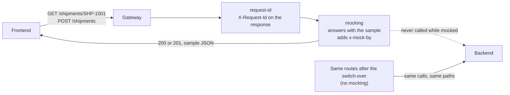

# Architecture — Mock before the backend

> [Overview](README.md) · [Business need](business-need.md) · **Architecture** · [Guides](guides.md) · [Agent prompt](helix-agent-prompt.md) · [Tests](tests.md) · [API reference](api-reference.md)

---

## What the gateway does here

The gateway publishes the agreed routes at a real URL and answers them itself,
with sample responses written into the API's configuration. No backend is
called. When the backend is ready, you deploy the same routes without the mock,
and the same calls go to the backend instead.

There are two routes:

1. **`GET /shipments/:shipmentId`** — track one shipment. The mock answers
   HTTP 200 (OK) with one fixed sample shipment.
2. **`POST /shipments`** — create a shipment. The mock answers HTTP 201
   (created), with a sample body and a `Location` header naming the new
   shipment.

For the full list of fields on every plugin mentioned here, see
[docs.digitalapi.ai/api-gateway](https://docs.digitalapi.ai/api-gateway).

## The words used on this page

| Word | What it means here |
|---|---|
| **Contract** | The routes, methods and JSON shapes both teams agreed on. In this package it is the OpenAPI file itself. |
| **Mock** | A route the gateway answers on its own, with a response you wrote in advance. |
| **Static mock** | A mock that gives every caller, and every id, the same answer. That is what this package builds. |
| **Switch-over** | Deploying the same routes without the mock, so calls reach the backend. |
| **Revision** | One saved version of an API's routes and plugins. Each environment runs one revision of an API at a time. |
| **Upstream** | The backend address the gateway sends calls to. |

## How a request flows

While the mock is on:

1. The frontend calls the gateway's host at `/shipments/...`, exactly as it will
   once the backend exists.
2. The gateway matches the route, sets the request id, then the mock answers.
3. The response carries the sample body, the status you chose, and the header
   `x-mock-by`, which says a mock produced it.
4. The backend is never called.

After the switch-over, steps 1 and 2 are unchanged. Instead of the mock, the
gateway sends the call on to the backend and passes its answer back.

## Execution order

| Plugin | Phase | Priority | What it does |
|---|---|---|---|
| `request-id` | rewrite | 12015 | Makes sure the response carries an `X-Request-Id`. |
| `mocking` | access | 1999 | Answers the request itself. Nothing after it runs and no backend is called. |

`request-id` sits at the document root and applies to every route, mocked or
not, so it stays through the switch-over. `mocking` sits on each route.

## Telling a mock from a real answer

Every mocked response carries the header `x-mock-by`, such as
`x-mock-by: HELIX/dev`. The part after `HELIX/` names the gateway's version, so
yours may differ. The header comes from the mock's `with_mock_header` setting,
which is on unless you turn it off. When the mock is removed, the header goes
with it. A frontend can show a "sample data" banner while it is present.

## The switch-over

Each environment runs one revision of an API. The switch-over is a new revision
of the **same** API: same routes, no `mocking`. Deploying it with **Force
Deploy** replaces the mocked revision on the same host and paths, so the
frontend's calls don't change. Rolling back is deploying the mocked revision
again.

A plain deploy of the new revision is refused while the mocked one is live
(*"Environment … already has revision … deployed for this API"*). Force Deploy
is the switch.

[`example/api-spec-basic.yaml`](example/api-spec-basic.yaml) is the switched-over
version. It adds one thing for the sample backend only:
`jsonplaceholder.typicode.com` has no `/shipments`, so `proxy-rewrite` maps
`/shipments/1` to its `/posts/1` and `/shipments` to `/posts`. Its answers are
posts, not shipments; they show that the call reached a backend. With your own
backend serving `/shipments`, leave `proxy-rewrite` out.

## When to use it

- The frontend, a mobile app or a partner needs a working URL before the backend
  exists.
- Both teams have agreed the contract and want one place that holds it.
- You want a demo or a test environment that never depends on a backend being
  up.

**Don't use it when** callers need answers that differ by id or by caller. A
static mock can't do that. Use [solution 12](../12-key-value-store/), which builds
each answer from stored per-caller values.

## Prerequisites

- An environment to deploy to (`test` on a free trial).
- **An upstream, even though the mock never calls it.** A revision with no
  upstream is refused at deploy: *"Upstream not configured for environment …
  Set upstream binding first."* Bind the backend you will switch to.

## Limits

- **Every id gets the same answer.** `GET /shipments/anything` returns
  `SHP-1001`. An unknown id never gets a 404 from the mock.
- **The mock doesn't read the request.** `POST /shipments` answers 201 whatever
  the body says, even an empty one, and stores nothing. A frontend can't test
  its error handling against it. To reject bad bodies at the gateway, see
  [solution 18](../18-validate-request-body/).
- **A `$` in a sample is read as a variable.** `$uri` becomes the request path,
  and `$12.50` becomes an empty string, with no error. Keep `$` out of sample
  values, for example by writing `12.50 USD`.
- **No CORS headers.** A browser app on another origin needs them; see the
  `cors` plugin in [solution 12](../12-key-value-store/).
- **The mock can't test the upstream.** A wrong upstream setting shows up only
  at the switch-over, as HTTP 502 (bad gateway) on every call. Check it before
  you switch.
- **Routes outside the contract don't exist.** `DELETE /shipments/SHP-1001` gets
  HTTP 404 `Route Not Found` from the gateway.
