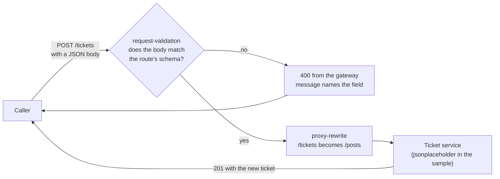

# Architecture — Validate the request body

> [Overview](README.md) · [Business need](business-need.md) · **Architecture** · [Guides](guides.md) · [Agent prompt](helix-agent-prompt.md) · [Tests](tests.md) · [API reference](api-reference.md)

---

## What the gateway does here

Before a request is sent on, the gateway reads its body and compares it with a
description of a good body, called a **schema**. If the body matches, the
request carries on to your backend as usual. If it doesn't, the gateway
answers with HTTP 400 (bad request) itself, and the request stops there.

The check is done by one plugin, `request-validation`, set on each route. The
sample API also uses `proxy-rewrite`, so the public path `/tickets` reaches the
backend's `/posts`, and `request-id`, which puts an `X-Request-Id` header on
every response, the gateway's own 400s included.

## The words used on this page

| Word | What it means |
|---|---|
| **Body** | The data a caller sends with a request, here a JSON object such as `{"title":"…","priority":"high"}`. |
| **Schema** | The description of a good body: which fields are required, what type each is, which values are allowed. Written in JSON Schema, the format OpenAPI documents use. |
| **Required** | A field that must be present. `null` counts as present, so a type rule is what stops `"title": null`. |
| **Type** | What kind of value a field holds: `string`, `number`, `object`, and so on. |
| **Enum** | A fixed list of allowed values. `priority` must be exactly `low`, `normal` or `high`. |
| **Rejected** | Answered by the gateway with a 400. The backend is never called. |

## How a request flows

Each route has its own rule:

| Route | Sent to the backend as | Rule |
|---|---|---|
| `POST /tickets` | `POST /posts` | A JSON object. `title` and `priority` are required. `title` is a string of at least one character; `priority` is `low`, `normal` or `high`. |
| `PATCH /tickets/:ticketId` | `PATCH /posts/:ticketId` | A JSON object. Nothing is required, but a `title` or `priority` that is sent follows the same rule. |

## Execution order

Plugins run in order of **priority**, highest first, not in the order they are
written in the spec. `request-validation` (priority 2800) runs before
`proxy-rewrite` (priority 1008), and both run in the gateway's first stage,
called the rewrite phase. So the body is checked before anything else is done
to the request. A refused request is never rewritten and never sent on.

## What the caller sees

The 400 is plain text (`content-type: text/plain`), one line, naming the first
field that failed. When several fields are wrong, fix one, and the next
request names the next one. These are the messages the sample API returns:

| The body | The 400 message |
|---|---|
| no `priority` | `property "priority" is required` |
| `"title": null` | `property "title" validation failed: wrong type: expected string, got userdata` |
| `"title": 42` | `property "title" validation failed: wrong type: expected string, got number` |
| `"title": ""` | `property "title" validation failed: string too short, expected at least 1, got 0` |
| `"priority": "urgent"` | `property "priority" validation failed: matches none of the enum values` |
| a list, such as `[{…}]` | `wrong type: expected object, got table` |
| not JSON at all | the parser's message, such as `Expected value but found invalid token at character 1` |
| no body | a short HTML error page, with no message |

Two of these need translating for a caller: **`userdata`** is how the checker
names a JSON `null`, and **`table`** is how it names a list. The enum message
doesn't list the allowed values, so put them in your API documentation.

If you'd rather send one fixed message, set `rejected_msg` on the route. It
replaces every message above, the no-body case included. See
[Variations](guides.md#variations) for the trade-off.

## How you know the backend never saw it

A rejected request leaves no trace on the backend. You can see that three ways:

- **The response headers.** The sample backend adds `X-Powered-By: Express` to
  everything it sends. The 201 and 200 carry it; the 400s don't.
- **The status.** The sample backend never answers 400 to these calls.
- **A trace.** Open a trace session ([solution 16](../16-request-tracing/)) and
  send a bad body. The record's outcome is **Upstream not called**, answered by
  `request-validation` in the rewrite phase, with no backend status.

`example/verify.sh` uses the first two.

## When to use it

- A backend fails badly (a 500, a crash, bad data saved) on a missing or
  wrong field, and the fix in the backend isn't ready.
- Several clients call the same API, and you want one place that says what a
  good request is.
- You want callers to get a clear 400, not a 500 they can't act on.
- Different operations on the same resource need different rules (create
  versus change).

Don't use it as the only check on values that need your data to judge, such as
"this ticket id exists" or "this user may set high priority". The backend still
has to do those.

## Prerequisites

- An API with JSON request bodies, deployed on the gateway.
- The rule for each route: required fields, types and allowed values. An
  OpenAPI document's request schema is usually a good start.

## What the check does not catch

These all reached the sample backend with a 201. Each has a fix in
[Variations](guides.md#variations):

- **A title of only spaces.** `"   "` is at least one character long. A
  `pattern` rule refuses it.
- **Fields you didn't list.** A typo such as `"priorty": "high"` next to a good
  `priority` passes, because the schema allows extra fields unless it says
  otherwise.
- **A form body.** A body sent as `application/x-www-form-urlencoded` (the
  format of a web form) is read as form fields and checked like JSON. With the
  right fields, it passes and is forwarded as a form. A header rule can require
  `content-type: application/json`.
- **A JSON body with no content type.** It is checked as JSON and passes if it
  matches, but the backend may not read it as JSON.
- **An empty change.** `PATCH /tickets/1` with `{}` matches a rule that
  requires nothing, and reaches the backend.

Also, the gateway passes the backend's response headers back unchanged. The
sample backend's 201 carries a `Location` header with its own host and `/posts`
path, not `/tickets`.
