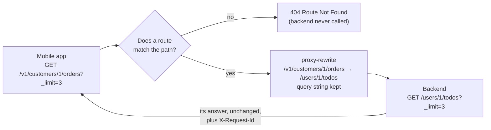

# Architecture — Stable public paths

> [Overview](README.md) · [Business need](business-need.md) · **Architecture** · [Guides](guides.md) · [Agent prompt](helix-agent-prompt.md) · [Tests](tests.md) · [API reference](api-reference.md)

---

## What the gateway does here

Each route has two paths: the one callers use, and the one the backend serves.
The gateway matches a call on the first, changes it to the second, and sends it
on. Callers never see the backend's paths, and the backend never needs to know
about the public ones.

| Words used on this page | What they mean |
|---|---|
| **Public path** | The path callers use, such as `/v1/customers/1`. It is the contract: once published, it doesn't change. |
| **Backend path** | The path your backend actually serves, such as `/users/1`. It can change whenever the backend team needs it to. |
| **Rewrite** | Changing the path of a call before the gateway sends it to the backend. The `proxy-rewrite` plugin does it, one rewrite per route. |
| **Query string** | The part of a URL after `?`, such as `?_limit=2`. |
| **Route Not Found** | The gateway's own HTTP 404 (not found), with the body `{"error_msg":"404 Route Not Found"}`, for a path no route serves. The backend is never called. |

## How a request flows

1. The gateway tidies the path first: it decodes `%2F` to `/` and resolves `./`
   and `../` segments. So `/v1/customers/1/../3` is customer 3, and
   `/v1/customers/../../users/1/todos` becomes `/users/1/todos`, before any
   route is looked at.
2. It looks for a route with that exact path. Matching is case-sensitive, and a
   trailing slash makes a different path. No match: HTTP 404 Route Not Found.
3. On a match, `proxy-rewrite` replaces the path. The query string is added
   back after the new path.
4. The backend answers, and the caller gets that answer with an `X-Request-Id`
   header added by `request-id`.

The backend's own paths (`/users`, `/users/1`, `/users/1/todos`) have no route,
so step 2 stops them. Learning a backend path doesn't help a caller.

## The two kinds of rewrite

| Public path | Rewrite | Backend path |
|---|---|---|
| `GET /v1/customers` | `uri: /users` | `/users` |
| `GET /v1/customers/:customerId` | `regex_uri: ["^/v1/customers/([^/]+)$", "/users/$1"]` | `/users/<id>` |
| `GET /v1/customers/:customerId/orders` | `regex_uri: ["^/v1/customers/([^/]+)/orders$", "/users/$1/todos"]` | `/users/<id>/todos` |

- **`uri`** is a fixed path. Use it when the public path has no id in it.
- **`regex_uri`** is a pair: a pattern that matches the public path, and the
  backend path to build from it. `([^/]+)` captures one path segment (the id,
  up to the next `/`), and `$1` puts it back. Use it whenever the public path
  carries an id. A fixed `uri` on that route would send every caller to the same
  record.
- **If the pattern doesn't match**, nothing is rewritten: the backend is asked
  for the public path itself, and usually answers 404.

## What happens to the query string

| Rewrite | Caller sends | Backend receives |
|---|---|---|
| `uri: /users` | `/v1/customers?_limit=2` | `/users?_limit=2` (kept) |
| `regex_uri` to `/users/$1/todos` | `/v1/customers/1/orders?_limit=3` | `/users/1/todos?_limit=3` (kept) |
| a target with its own `?`, such as `/todos?userId=$1` | `/v1/customers/1/orders?userId=2` | `/todos?userId=1&userId=2` (added after `&`) |

- **Kept, in both forms.** Neither `uri` nor `regex_uri` drops the query
  string, and neither changes it. Repeated names and encoded characters arrive
  as the caller sent them.
- **The pattern never sees it.** `regex_uri` is matched against the path only,
  so don't write `?` handling into the pattern.
- **Added after `&` when the target has its own query string.** The caller can
  then send a name the rewrite already uses, and the backend receives it twice.
  What happens next is up to the backend: the test backend used here returns
  the records for **both** ids, and takes the **first** of two `_limit` values.
  If the backend needs the id in its query string, see
  [The backend moved](guides.md#the-backend-moved).

An encoded `?` inside an id (`%3F`) stays part of the path. It can't start a
query string of its own.

## Execution order

Two plugins, set by priority (higher runs first):

| Plugin | Priority | Scope | Job |
|---|---|---|---|
| `request-id` | 12015 | every route | puts an id on the response, so a caller's report can be matched to a gateway record |
| `proxy-rewrite` | 1008 | each route, its own rewrite | changes the path before the call is sent on |

Neither one stops a call. Every call that matches a route reaches the backend.

## Reading a failure: whose 404 is it?

| Response | Who answered | What it means |
|---|---|---|
| 404 `{"error_msg":"404 Route Not Found"}`, no `X-Request-Id` | **The gateway** | No route has this path: a typo, a wrong case, a trailing slash, a backend path, or an API that isn't deployed here. |
| 404 with the backend's own body and an `X-Request-Id` (`{}` on the test backend) | **The backend** | The route matched and the rewrite ran. The backend has no such record, or the rewrite built a path it doesn't serve. |
| 200, but the wrong record | **The rewrite** | A fixed `uri` on a route that carries an id. |

## When to use it

- Your clients call the backend's own paths, and a backend rename breaks them.
- You want a versioned public contract (`/v1/...`) that you can keep while the
  backend changes.
- You are moving a backend to a new host or a new path layout, and want clients
  to notice nothing.
- You want to stop callers reaching backend paths you never meant to publish.

**Not for:** changing the response body (field names, shapes). A rewrite moves
the call; the backend's answer comes back as it is. For body changes, see
[solution 10](../10-data-mask/) or [solution 09](../09-xml-to-json/).

## Prerequisites

- An account with an environment (a free trial's `test` environment is enough).
- A backend reachable from the gateway. The example uses the public test backend
  `jsonplaceholder.typicode.com`, where customers are its users and orders are
  its todos.

## Limits

- **No sign-in.** The example is open to anyone, to keep the focus on paths.
  Add identity from [solution 08](../08-api-key/) before you publish it.
- **Paths only.** Bodies, field names and status codes come back unchanged.
- **One environment, one set of paths.** Every API deployed to the same
  environment shares its host, so two APIs can't both serve `/v1/customers`.
- **The query string always passes through.** `proxy-rewrite` can't remove a
  caller's parameter. If the backend must not act on some parameters, it has to
  ignore or reject them itself.
