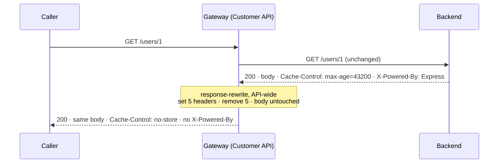

# Architecture — Security headers

> [Overview](README.md) · [Business need](business-need.md) · **Architecture** · [Guides](guides.md) · [Agent prompt](helix-agent-prompt.md) · [Tests](tests.md) · [API reference](api-reference.md)

---

## What the gateway does here

Nothing on the way in. The request reaches your backend exactly as the caller
sent it. On the way back, after the backend has answered and before the caller
sees anything, one rule edits the response **headers**: it sets five, removes
five, and leaves the body alone.

That rule is the `response-rewrite` plugin, configured once at the top of the
API spec so it covers every route. A second plugin, `request-id`, adds an
`X-Request-Id` to every response, so a caller reporting a problem has an id to
quote.

## How a response flows



## The rule

```yaml
x-helix-gateway:          # at the top of the spec: every route of the API
  plugins:
    response-rewrite:
      headers:
        set:
          X-Content-Type-Options: nosniff
          Cache-Control: no-store
          X-Frame-Options: DENY
          Content-Security-Policy: "default-src 'none'; frame-ancestors 'none'"
          Referrer-Policy: no-referrer
        remove: [X-Powered-By, Server, Via, X-AspNet-Version, X-AspNetMvc-Version]
```

The full file, with comments: [`example/api-spec.yaml`](example/api-spec.yaml).

## What each header does

| Header | Value | What it stops |
|---|---|---|
| `X-Content-Type-Options` | `nosniff` | A browser treating a JSON body as HTML or script because it "looks like" one. |
| `Cache-Control` | `no-store` | A browser, proxy or CDN keeping a copy of customer data. The sample backend asks for 12 hours. |
| `X-Frame-Options` | `DENY` | Another site showing the response inside a frame (clickjacking). For older browsers. |
| `Content-Security-Policy` | `default-src 'none'; frame-ancestors 'none'` | The response loading anything, if a browser ever renders it, and being framed (the modern form of the line above). |
| `Referrer-Policy` | `no-referrer` | The URL, with any ids in it, being sent onward to another site. |

These are the values the OWASP REST Security Cheat Sheet recommends for an API
that returns JSON. A web page needs a different policy; an API doesn't.

## Set, remove, and why not add

- **`set`** puts a header on the response with exactly this value. If the
  backend already sent one with that name, it is **replaced**. The sample
  backend sends `Cache-Control: max-age=43200`; the caller receives one
  `Cache-Control` header, and it says `no-store`.
- **`remove`** takes a header off. A name the backend doesn't send costs
  nothing, so the list covers common stacks, not only this backend.
- **`add`** also exists, and is the wrong choice here. It appends a second
  header beside the backend's, so the caller would receive both
  `max-age=43200` and `no-store`.

## Which responses get the headers

| Response | Headers? |
|---|---|
| A success from your backend | Yes |
| An error from your backend (`404`, `500`) | Yes. The sample's `GET /users/999999` 404 carries all of them. |
| A response a plugin produces itself on one of the API's routes, such as a mock | Yes, when the rule is API-wide |
| A path the API has no route for | **No.** The request never reaches the API, so the gateway answers with its plain `404 Route Not Found`. |

## Headers only: the body is never read

This `response-rewrite` has a `headers` field and nothing else. With no `body`
and no `filters`, it never reads the response body, so the caller receives
exactly the bytes the backend sent. [`example/verify.sh`](example/verify.sh)
checks that, byte for byte, on a list, a single record and an error.

[Solution 10](../10-data-mask/) uses the same plugin the other way: its
`filters` rewrite the body to mask emails and phone numbers. Same plugin,
different job:

| | This package | Solution 10 |
|---|---|---|
| Field used | `headers` | `filters` |
| Changes | response headers | response body text |
| Body the caller gets | byte-identical to the backend's | rewritten |
| Where it sits | API-wide, once | on each route |

## One rule per route

A route can carry its own `response-rewrite` too, for example solution 10's
masking. When it does, **the route's block replaces the API-wide one on that
route. The two are not merged.** That route then loses every security header
here, with no error and no warning.

The fix is to copy the `headers` block into the route's own `response-rewrite`,
beside its `filters`. Then that route gets both. Every other route keeps the
API-wide rule. Other plugins are not affected: an API-wide `request-id` still
runs on a route that has its own `response-rewrite`.

## HSTS, and why it is not in the block

`Strict-Transport-Security` tells a browser to use only HTTPS for the host for
a set time. It describes the **host and its TLS**, not one API: with
`includeSubDomains` it covers every subdomain too. So it is normally set once,
where TLS ends for the host, by whoever owns the domain. If one API set it, every
other API on the host would inherit the decision.

Check what your callers already receive with a GET
(`curl -s -D - -o /dev/null https://<YOUR_GATEWAY_HOST>/users/1`). Not
`curl -I`: that sends HEAD, which these GET routes don't serve, so it gets a
404 without the five headers.
If nothing sends it, [add it to `set`](guides.md#add-hsts).

## What it does not do

- **Authenticate anyone.** Headers instruct browsers and caches; they don't stop
  a caller. Customer data needs an identity check too ([solution 08](../08-api-key/)).
- **Change your backend's CORS headers.** The sample backend sends its own, and
  they pass through. Deciding which browser origins may call the API is a
  separate job.
- **Remove headers it isn't told about.** The sample backend also sends headers
  from its own CDN. They pass through. Add a name to `remove` to take it off.
- **Cover other APIs.** The rule belongs to this API. Each API that needs it
  carries the same block.

## The sample API

[`example/api-spec.yaml`](example/api-spec.yaml) proxies the public
jsonplaceholder service, whose `/users` records are customer data: names,
emails, phone numbers and home addresses.

| Route | What it shows |
|---|---|
| `GET /users` | the headers on a list, 10 records, about 5.6 KB |
| `GET /users/{userId}` | the headers on one record; `/users/999999` shows them on the backend's 404 |
| all | `request-id`: an `X-Request-Id` on every response. If a request already carries one, the gateway keeps it rather than making a new one. |
