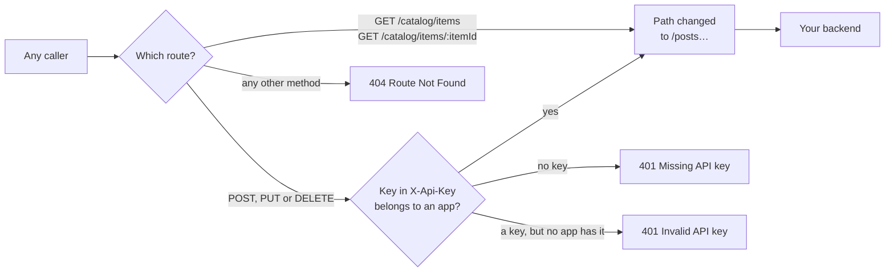

# Architecture — Public reads, protected writes

> [Overview](README.md) · [Business need](business-need.md) · **Architecture** · [Guides](guides.md) · [Agent prompt](helix-agent-prompt.md) · [Tests](tests.md) · [API reference](api-reference.md)

---

## What the gateway does here

For every request it answers one question first: **which route is this?** Then
it runs the plugins that apply to that route. A read route has no key check, so
the request goes straight on to your backend. A write route has one, so the
request goes on only if its key belongs to an app.

Nothing in your backend changes, and nothing in the read requests changes.

## The model

| Word | What it means |
|---|---|
| **Route** | One method on one path. `GET /catalog/items` and `POST /catalog/items` are two routes on the same path, and each has its own plugins. |
| **API-wide plugin** | Applies to every route of the API. In a spec it sits in the `x-helix-gateway` block at the top level of the file; in the UI its scope is **Entire Revision**. |
| **Route plugin** | Applies to one route only. In a spec it sits under that path and method; in the UI its scope is **Specific endpoint**. |
| **App** | One caller, such as one partner. The control plane gives it a key and a secret. The caller sends the **key**. |
| **Product** | A bundle of APIs that apps sign up to. An app needs one to get its key. |

A route runs its own plugins **and** every API-wide plugin. So the rule for this
solution is simple: anything every caller should get goes API-wide; the key
check goes on the write routes, one by one.

| Plugin | Where | Why there |
|---|---|---|
| `helix-auth` (the key check) | On `POST /catalog/items`, `PUT /catalog/items/:itemId`, `DELETE /catalog/items/:itemId` | Only the writes need a key. API-wide, it would refuse every read without one. |
| `proxy-rewrite` | API-wide | Every route needs the same path change: `/catalog/items…` becomes `/posts…` on the sample backend. One rule covers all five. |
| `request-id` | API-wide | Every response, read or write, gets an `X-Request-Id` a partner can quote. |

The two read routes carry no plugin of their own. That is what "open" looks like
in the configuration.

## How a request flows

On a write route the key check runs **before** the path change, whatever order
you add the plugins in: the gateway orders plugins by priority, not by where
they appear. A refused request stops at the key check, and your backend is never
called.

A method the API doesn't list (`PATCH`, for example) has no route at all. The
gateway answers `404 Route Not Found`, and nothing reaches your backend. Open
reads don't mean open everything. That includes `HEAD`: a `GET` route doesn't
answer it.

## What the key check does, and what it doesn't

**It does:**

- Read the key from the `X-Api-Key` header, and only from there. The right key
  in another header, or in the URL, counts as no key.
- Find the app that owns it, and refuse the request with 401 if there is none.
- Tell a missing key (*Missing API key in request*) from a wrong one (*Invalid
  API key in request*). Both are 401.

**It doesn't:**

- **Check which product the app is on.** A key from any app in the environment
  opens the writes, even an app whose product doesn't include this API. To let
  in only the apps on this API's product, add the product check from
  [solution 01](../01-api-products/).
- **Hide the key from your backend.** `X-Api-Key` is passed on as the partner
  sent it. To remove it, see [Variations](guides.md#variations).
- **Look at reads at all.** A partner whose key you switched off can still read
  the catalogue, like everyone else. That is the design: reads are public.
- **Limit how often a partner writes.** That is a quota on the product,
  [solution 01](../01-api-products/).

The 401 body is JSON, but it arrives with the content type `text/plain`. A
client that only parses JSON when the content type says so needs to parse it
itself.

## Which credential fits

A key in a header is the simplest thing a partner can send, and the right
choice when partners call from a server or a scheduled job. If a partner can
fetch and refresh a short-lived token, a token limits the damage of a leak:
see [solution 02](../02-oauth-jwt/). Whatever the credential, the placement
stays the same: on the writes only.

## The sample API

[`example/api-spec.yaml`](example/api-spec.yaml) is the catalogue on a public
test backend, `jsonplaceholder.typicode.com`, whose `/posts` collection stands in
for catalogue items:

| Route | Plugins on the route | What it does |
|---|---|---|
| `GET /catalog/items` | none | Lists 100 items from `/posts`. |
| `GET /catalog/items/:itemId` | none | Returns one item from `/posts/:itemId`. |
| `POST /catalog/items` | `helix-auth` | Adds an item. The backend answers 201 with the new item and an id. |
| `PUT /catalog/items/:itemId` | `helix-auth` | Changes an item. The backend answers 200. |
| `DELETE /catalog/items/:itemId` | `helix-auth` | Removes an item. The backend answers 200. |
| every route | `proxy-rewrite`, `request-id` (API-wide) | Path change and a request id. |

The test backend answers writes as if it stored them, but stores nothing, so
you can run the examples as often as you like.
