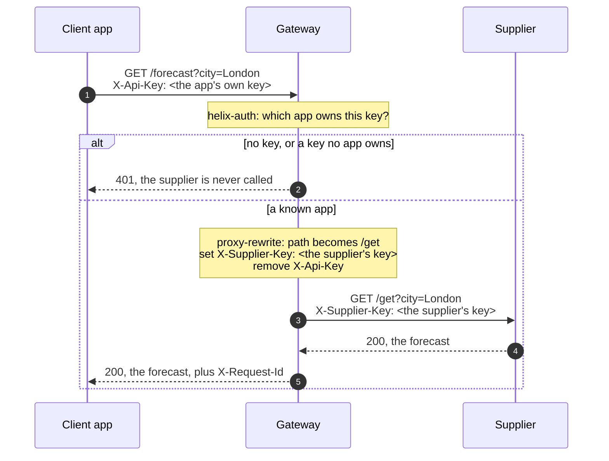

# Architecture — Keep a supplier's API key at the gateway

> [Overview](README.md) · [Business need](business-need.md) · **Architecture** · [Guides](guides.md) · [Agent prompt](helix-agent-prompt.md) · [Tests](tests.md) · [API reference](api-reference.md)

---

## What the gateway does here

Two keys, each kept where it belongs:

- **Each client has its own key** for the gateway. The mobile app, the web app
  and each partner get a different one. A client sends it in the `X-Api-Key`
  header (a named value sent with the request).
- **The supplier's key stays at the gateway.** It is written into the API's
  configuration once. The gateway adds it to every request on the way to the
  supplier, and no client ever holds it.

For every call, the gateway checks the client's key, swaps it for the supplier's
key, and passes the request on. The supplier's answer goes back to the client
unchanged.

For the full list of fields on every plugin, see
[docs.digitalapi.ai/api-gateway](https://docs.digitalapi.ai/api-gateway).

## The words used on this page

| Word | What it means here |
|---|---|
| **Supplier** | The outside company whose API you call, here a weather data provider. In gateway terms it is the **upstream**: the backend the gateway forwards requests to. |
| **Supplier key** | The one key the supplier gave you. It goes in `X-Supplier-Key` (or whatever header your supplier names). |
| **Client** | Anything that calls your API: your mobile app, your web app, a partner's system. |
| **App** | One client, as the gateway knows it. Each app has its own key. |
| **Client key** | The key of one app, sent in `X-Api-Key`. The control plane (where you manage APIs, products and apps) creates it. |
| **Product** | A bundle of APIs that apps sign up to. Signing up to a product is how an app gets its key. |
| **Plugin** | A ready-made feature you switch on for an API or a route. Three are used here. |

## How a request flows

1. The client sends its own key. It has never seen the supplier's key.
2. The gateway checks the key. No key gets HTTP 401 (not authenticated) with
   `Missing API key in request`. A key that belongs to no app gets 401 with
   `Invalid API key in request`. Either way the supplier is not called.
3. A known key goes on. The gateway changes the path to the supplier's, adds the
   supplier's key and removes the client's key.
4. The supplier answers. The gateway passes the answer back and adds an
   `X-Request-Id` header, an id for this one call.

The query string (`?city=London`) is passed on to the supplier unchanged.

## Execution order

The plugins run by priority, highest first, not in the order they appear in the
spec. The key check and the header change both run in the same early stage of
the request (the rewrite phase):

| Order | Plugin | Priority | What it does here |
|---|---|---|---|
| 1 | `request-id` | 12015 | Gives the call an id, returned in `X-Request-Id`. |
| 2 | `helix-auth` | 2450 | Reads `X-Api-Key` and finds the app. Refuses the call if there is none. |
| 3 | `proxy-rewrite` | 1008 | Sets the path to `/get`, sets `X-Supplier-Key`, removes `X-Api-Key`. |

**The order is why removing the client's key is safe.** `helix-auth` has
already read `X-Api-Key` by the time `proxy-rewrite` removes it, so the key
check still works.

## What the supplier receives

| Header | Without the remove | With the remove (this package) |
|---|---|---|
| `X-Supplier-Key` | the supplier's key | the supplier's key |
| `X-Api-Key` | **the client's own key** | not sent |
| `X-Consumer-Username` · `X-Credential-Identifier` | added by the gateway: ids of the calling app | the same |

`helix-auth` has no setting to hide the client's key. It passes `X-Api-Key` on
exactly as the client sent it. **Without the remove, every client's own key would
reach the supplier**, and end up in the supplier's logs. The remove is what stops
that.

The two ids the gateway adds are not secrets, but they tell the supplier which
of your apps called. To remove them too, see
[Variations](guides.md#variations).

If a client sends its own `X-Supplier-Key`, the gateway replaces it. `set`
replaces a header; it never keeps the client's value. So a client can't choose
which supplier key is used.

## Reading a failure

| What the client sees | Who answered | What it means |
|---|---|---|
| 401 `Missing API key in request` | the gateway | No `X-Api-Key` header, or the key was sent somewhere else (a different header, the URL). |
| 401 `Invalid API key in request` | the gateway | The key belongs to no app: mistyped, the app's secret or id instead of its key, or the app was deleted. |
| An error from the supplier, often 401 or 403 | the supplier | The supplier didn't accept its key. Usually the placeholder `<SUPPLIER_API_KEY>`, or a reference such as `<ENV:...>`, was saved instead of the real key. The gateway sends what is saved, as written. |
| 502 or 504 | the gateway | The supplier couldn't be reached. Check the upstream. |

## When to use it

- One supplier key is shared by several clients, and changing it means releasing
  each of them again.
- The key is in code that runs on devices or in browsers, where anyone can read
  it.
- You need to stop one client without changing the key for all the others.
- You want to know which of your clients is calling, even though the supplier
  only sees one key.

**Don't use it** when every client must have its own account with the supplier,
for billing or legal reasons. Then each client needs its own supplier key.

## Prerequisites

- An upstream for the supplier's host. To try it, `postman-echo.com` on port
  443 with HTTPS: a public test service that echoes back the request it got.
- A test value for `<SUPPLIER_API_KEY>` while the upstream is postman-echo, and
  the supplier's real key once it points at your supplier.
- A product that includes this API, a developer, and one app per client.

## Limits worth knowing

- **The supplier key is stored as plain text in the API's configuration.** The
  gateway reads no environment variables, so `<ENV:...>` is sent as that text.
  A `$` is read as the start of a gateway variable: `${...}` sends an empty
  value, and a key with a `$` in it can arrive shortened. Anyone who can open
  this API's plugins in the console can read it. Keep the real value out of any
  file you commit, and limit who can edit the API.
- **Changing the supplier key means a new revision** (a new saved version of the
  API): clone, change the value, deploy. Clients don't change.
- **Every route that calls the supplier needs its own `proxy-rewrite`.** The key
  check covers the whole API, including routes you add later. The supplier key
  and the remove are set per route, because each route has its own supplier
  path.
- **The key check doesn't look at which product an app is on.** Any app's key in
  the environment is accepted. To let in only the apps on this API's product,
  add `api-product-enforcer` ([solution 01](../01-api-products/)).
- **A trace shows the supplier key.** A trace session (see
  [solution 16](../16-request-tracing/)) records the headers each plugin
  changes, without hiding them. Limit who can read traces.
- **The test backend echoes the key.** postman-echo.com returns the request it
  received, so its response body contains the supplier key, and the client can
  read it there. That is the echo service at work. A real supplier does not send
  its key back.
