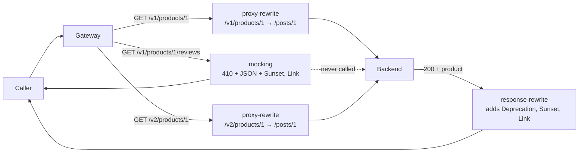

# Architecture — retiring an old API version in stages

> [Overview](README.md) · [Business need](business-need.md) · **Architecture** · [Guides](guides.md) · [Agent prompt](helix-agent-prompt.md) · [Tests](tests.md) · [API reference](api-reference.md)

---

## What the gateway does here

v1 and v2 of the API run side by side behind the same gateway. The gateway
treats each v1 route according to its stage:

- **Deprecated** (`GET /v1/products/:productId`). The call goes to the backend as
  before. On the way back, the gateway adds three headers that say v1 is
  deprecated, when it stops working, and where the replacement is.
- **Retired** (`GET /v1/products/:productId/reviews`). The gateway answers
  HTTP 410 (gone) itself, with a short JSON body and the same kind of headers.
  The backend is never called.
- **Current** (both `/v2/...` routes). Passed through to the backend, with no
  extra headers.

Your backend doesn't change. It never learns which version a caller used: both
versions reach the same backend path.

## The words used on this page

| Word | What it means here |
|---|---|
| **Deprecated** | Still works, but has an end date. Callers should move. |
| **Retired** | No longer works. The gateway says so, and says where to go. |
| **Removed** | The route is gone. Callers get the gateway's plain `404 Route Not Found`. |
| **Successor** | The v2 address that replaces a v1 address. |
| **`Deprecation`** | A response header saying the endpoint is deprecated, and since when ([RFC 9745](https://www.rfc-editor.org/rfc/rfc9745)). |
| **`Sunset`** | A response header saying when the endpoint stops working ([RFC 8594](https://www.rfc-editor.org/rfc/rfc8594)). |
| **`Link`** | A response header pointing at a related address ([RFC 8288](https://www.rfc-editor.org/rfc/rfc8288)). `rel="successor-version"` ([RFC 5829](https://www.rfc-editor.org/rfc/rfc5829)) marks it as the replacement. |

## The headers, exactly

| Header | Value on the deprecated route | Format |
|---|---|---|
| `Deprecation` | `@1777593600` | `@` then whole seconds since 1 January 1970, UTC. This one is 1 May 2026, 00:00 UTC. |
| `Sunset` | `Wed, 31 Mar 2027 23:59:59 GMT` | An HTTP date, always in GMT, the same format as the `Date` header. |
| `Link` | `</v2/products/1>; rel="successor-version"` | The address in angle brackets, then its relation. Built per request. |

The two dates use **different formats**, and that is the standard, not a
mistake. `Deprecation` is a structured-field date; an HTTP date there is
wrong, and so is `true`, which an older draft used. Both dates are in UTC.

The retired route sends `Sunset: Wed, 30 Sep 2026 23:59:59 GMT`, a date in the
past: the day it was retired. RFC 8594 allows a past date.

### How the Link follows the product id

`$uri_param_productId` in a header value is replaced by the `:productId` the
caller asked for. So `GET /v1/products/42` gets `</v2/products/42>`, and a
caller's code can go straight to the replacement for **that** product. The same
variable builds the address in the 410's body. It works in `response-rewrite`
headers, and in `mocking`'s headers and body.

## How a request flows

## Execution order

Each plugin runs in a fixed stage of the request. Within a stage, the higher
priority runs first.

| Plugin | Priority | Stage | What it does here |
|---|---|---|---|
| `request-id` | 12015 | rewrite, and on the way back | Puts `X-Request-Id` on every response, the 410 included. API-wide. |
| `mocking` | 1999 | access | Answers the retired route with 410. Nothing after it runs, and the backend is not called. |
| `proxy-rewrite` | 1008 | rewrite | Changes `/v1/products/1` and `/v2/products/1` to `/posts/1` before the backend sees it. |
| `response-rewrite` | 899 | on the way back (header filter) | Adds the three headers to the backend's answer, whatever its status. |

A trace of the retired route shows **Upstream not called**, answered by
`mocking` in the access stage, with no backend status. A trace of the
deprecated route shows `response-rewrite` in the header filter stage and the
backend's status.

## The four stages, in order

| Stage | What callers see | How you get there |
|---|---|---|
| **1. Announce** | Nothing yet. You tell partners the dates, in your changelog and by email. | No gateway change. |
| **2. Headers** | v1 works and every response carries `Deprecation`, `Sunset` and `Link`. | `response-rewrite` on each v1 route. |
| **3. 410** | The endpoint answers 410 with the successor address. | Replace the route's `proxy-rewrite` and `response-rewrite` with `mocking`. |
| **4. Remove** | `404 Route Not Found`, like any address that never existed. | Delete the route. Optional: a 410 costs nothing to keep. |

Each stage is a new revision: clone, change, deploy. Rolling back is deploying
the previous revision again.

## Why 410, not 404 or a redirect

| Answer | What it tells the caller | Use it when |
|---|---|---|
| **410 Gone** | This address existed and was removed on purpose. It won't come back. | The endpoint is retired. The body and `Link` say where to go. |
| **404 Not Found** | Nothing here, for no stated reason. It could be a typo, a missing record or an outage. | Never for a retirement. This is what caused the priority tickets. |
| **301 or 308 redirect** | Same thing, new address. Follow it. | Only when v2 is a drop-in replacement: the same fields, the same meaning. Otherwise callers get a different shape without noticing, and nobody migrates. |

v1 to v2 is usually not a drop-in replacement, which is why this package uses
headers while v1 works and 410 once it doesn't.

## When to use it

- You are replacing an API version and some callers can't be reached directly.
- You want to retire one endpoint at a time, not the whole version at once.
- You want callers' code, logs or SDKs to notice the change without anyone
  reading an email.

## Prerequisites

- An API deployed to an environment, with the new version's routes in place
  first. A successor address that doesn't work yet is worse than none.
- The dates agreed: when v1 was deprecated, and when it ends.

## Limits

- **Headers tell; they don't force.** A caller whose code ignores headers learns
  at stage 3, from the 410. Watch v1 traffic in analytics (solution 04) before
  each stage.
- **The id is copied as the caller sent it.** A caller who puts `"` or `>` in
  their own product id gets a malformed `Link` header or 410 body, in their own
  response only. Line breaks stay encoded, so a caller can't add headers.
- **Browsers hide these headers from scripts on other sites** unless the
  response lists them in `Access-Control-Expose-Headers`. See
  [Variations](guides.md#variations).
- **One `Sunset` per route.** Every v1 route can carry its own date, but each
  route has exactly one.
