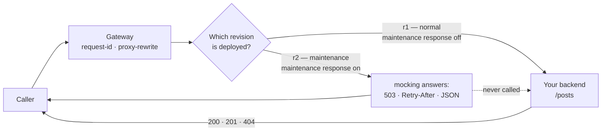

# Architecture — Maintenance mode

> [Overview](README.md) · [Business need](business-need.md) · **Architecture** · [Guides](guides.md) · [Agent prompt](helix-agent-prompt.md) · [Tests](tests.md) · [API reference](api-reference.md)

---

## What the gateway does here

Two things, one at a time. In the **normal** state it passes each call on to
your backend, as any API does. In the **maintenance** state it answers each
call itself with a fixed 503 response, and your backend is not called at all.

Which state you're in depends only on which revision is deployed. There is no
flag to flip on a live API: a deployed revision can't be edited, so you deploy
a different one.

## The words used on this page

| Word | What it means |
|---|---|
| **Revision** | One numbered version of an API's routes and plugins (`r1`, `r2`…). Only one revision of an API is live in an environment at a time. |
| **Clone Revision** | Makes an editable copy of a revision, with the same routes, plugins and upstream. |
| **Force Deploy** | Deploys a revision in place of the one that is live now. The replaced revision is kept, unchanged, ready to deploy again. |
| **Maintenance response** | The `mocking` plugin, set up to answer every call with a 503. In the sample spec it is already there, switched off. |
| **`Retry-After`** | A standard response header that tells the caller when to try again: a date, or a number of seconds. |

## How a request flows

**Normal state (`r1`).** The call arrives at `/bookings`. The gateway gives it
an id, changes the path to the backend's `/posts`, and passes it on. The
backend's answer goes back to the caller unchanged, so a booking that doesn't
exist is still the backend's own 404.

**Maintenance state (`r2`).** The same two steps run, then the maintenance
response answers: 503, `Retry-After`, the JSON message, and the request id. The
call stops there. It never reaches the backend, so a `POST` body is never
delivered and a booking that doesn't exist gets the same 503 as every other
call.

## Execution order

The gateway runs plugins in stages, and within a stage by priority, highest
first. A request trace of a call during maintenance shows this order:

| Stage | Plugin | Priority | What it does here |
|---|---|---|---|
| rewrite | `request-id` | 12015 | Gives the call an id. |
| rewrite | `proxy-rewrite` | 1008 | Changes `/bookings…` to `/posts…` for the backend. |
| access | `mocking` | 1999 | In maintenance only: answers 503 and stops the call. |
| header filter | `request-id` | 12015 | Puts `X-Request-Id` on the response, the 503 included. |

The access stage comes after the rewrite stage, so the path change runs in
both states. That's harmless: in maintenance, nothing uses the changed path.

## The switch

Switching on is three actions: **clone** the live revision, switch the
maintenance response **on** in the copy and set the end time, then **deploy**
the copy with force. Switching off is one: deploy the earlier revision with
force.

- **It's quick.** The new answer reaches the gateway within a second or two of
  the deploy. Calls made during the switch get either the old answer or the new
  one.
- **It can't drift.** The maintenance revision is a copy of the live one, so it
  has the same routes. Clone again for each window, so the copy picks up any
  route you've added since last time.
- **Switching back changes nothing.** The earlier revision was never edited.
  Deploying it again restores exactly what was live before.

## Why `Retry-After` is a date here

The maintenance response is fixed text in the configuration. It sends the same
`Retry-After` value all through the window.

- **A date** (`Sat, 07 Nov 2026 03:00:00 GMT`) means the same moment whenever
  it's read. That's right for a window with a known end.
- **A number of seconds** (`3600`) is counted from when each response arrives.
  Sent all window long, it tells a caller at 02:05 "03:05" and a caller at 02:55
  "03:55". Use seconds only when the end isn't known: `300` then means "check
  again in 5 minutes".

The date is always in GMT, in exactly this shape: day name, two-digit day,
month, year, 24-hour time, `GMT`. Put the same time in the JSON body as well
(`retry_after`, in ISO 8601 form such as `2026-11-07T03:00:00Z`), so an app can
show it in the user's own time zone.

## Reading a failure: who answered?

| What the caller got | Who answered | What it means |
|---|---|---|
| `503` with `Retry-After` and the JSON message | **The gateway** | Maintenance is on. |
| `200`, `201` or `404`, with the backend's own headers | **Your backend** | Maintenance is off. |
| `404` with `{"error_msg":"404 Route Not Found"}` | **The gateway**, no route matched | The path or method isn't part of this API, in either state. |
| `502` or a timeout | **The gateway**, the backend failed | Maintenance is off but the backend is down: the situation this package exists to avoid. |

A request trace settles it for one call: during maintenance the record says
**Upstream not called**, answered by `mocking`. See
[solution 16](../16-request-tracing/).

## When to use it

- A planned outage with a known window: a database migration, a data centre
  move, a backend upgrade.
- A backend that has to be fully stopped, with no traffic at all, while it
  changes.
- An incident where you'd rather show a clear message than errors, while you
  work on it. Use a number of seconds for `Retry-After` then.

Don't use it for one slow or failing endpoint while the rest is fine: put the
maintenance response on that route only (see
[Variations](guides.md#variations)). Don't use it for traffic limits either:
that's a quota, answered with 429, as in [solution 01](../01-api-products/).

## Prerequisites

- A deployed API with an upstream, in the environment you'll switch.
- Permission to clone and deploy revisions of that API.
- Apps that read `Retry-After` and show the message. The gateway sends them;
  your apps decide what the user sees.

## Limits

- **Only this API's routes.** A path or method the API doesn't have still gets
  `404 Route Not Found`. Each API needs its own maintenance revision.
- **No automatic end.** The gateway doesn't switch back at the stated time.
  Someone deploys the earlier revision, by hand, by script or with the Helix
  Agent.
- **One fixed message.** The time and text are set when you switch on. To change
  them, clone the maintenance revision, edit the copy, and deploy it.
- **Key checks run first.** If your API checks keys (solutions 01 and 08), that
  check runs in the rewrite stage, before the maintenance response. A call with
  a missing or wrong key still gets 401 during maintenance.
- **Browser apps need CORS headers on the 503.** A web page calling from another
  domain can only read a response that carries CORS headers. In the sample,
  those headers come from the backend, so the maintenance response has none.
  Give the API its own CORS settings if browser apps call it, and check a
  maintenance call from a browser before the real window.
